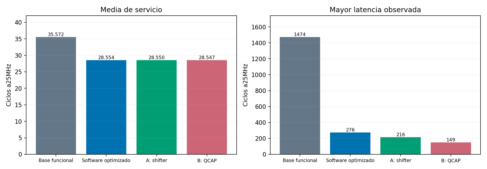
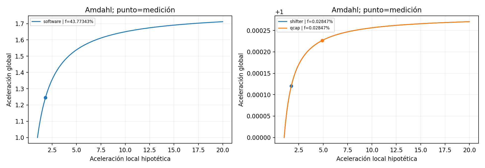
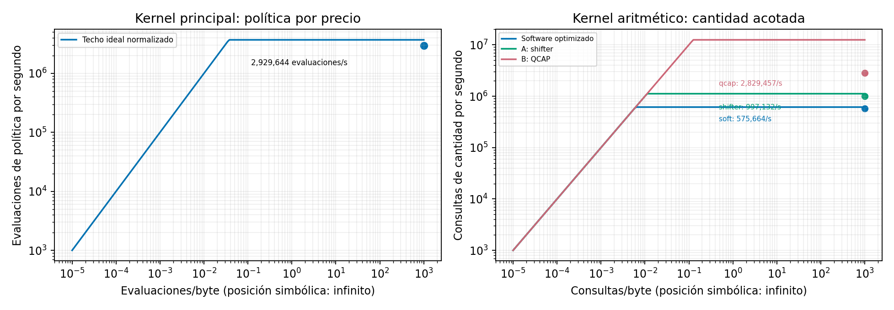

# M105-225: mediciones, optimización e imagen elegida

24 de noviembre de 2026. **Etapas 4 y 5 completadas. Selección: M105-225 con software optimizado sobre la ISA original de Espino, sin nuevas extensiones en la imagen final.** Se comparó la base de 85 instrucciones, la mejora solo software y dos alternativas de hardware: shifter acotado y QCAP. Las cuatro usan las mismas bandas 105/225 y conservan todas las decisiones bursátiles.

**[Informe técnico en PDF: 7 páginas](Informe_M105_225_mediciones_e_imagen.pdf).** Incluye perfil, IC/ciclos/CPI/tiempo, Amdahl, LUTs/BRAM/Fmax, Ops/s, roofline, referencias financieras e identificación del bitstream. [Decisión financiera y PDF de 78 series](https://github.com/abowen1/Proyecto-4-AC/blob/pre-entrega/docs/estrategia/seleccion_M105_225_2026-11-24/README.md).

## Resultado y justificación

La base funcional promedia 35,57226 ciclos por precio. La elegida promedia **28,55371 ciclos**: reducción del **19,73%** del tiempo de servicio, speedup **1,245802×**. El máximo observado en las 78 series pasa de 1474 a **276 ciclos**(58,96 a 11,04 µs), reducción del 81,28%. Todos los ensayos conservan decisiones, caja, inventario, presupuesto y resultado financiero: **patrimonio medio 18.079,33**.

| Implementación | Ciclos medios | Mayor latencia (ciclos) | IC medio | CPI servicio | Media µs | Máximo µs | LUT4 | LC | BRAM | Fmax MHz |
|---|---:|---:|---:|---:|---:|---:|---:|---:|---:|---:|
| Base funcional | 35,57226 | 1474 | 15,589 | 2,2819 | 1,4229 | 58,96 | 921 | 1091 | 12 | 46,07 |
| Software optimizado(elegido) | 28,55371 | 276 | 12,394 | 2,3039 | 1,1421 | 11,04 | 921 | 1091 | 12 | 46,07 |
| A: shifter acotado | 28,55027 | 216 | 12,392 | 2,3039 | 1,1420 | 8,64 | 1031 | 1202 | 12 | 42,24 |
| B: QCAP | 28,54723 | 149 | 12,390 | 2,3040 | 1,1419 | 5,96 | 1008 | 1186 | 12 | 43,87 |

LUT4 es el número de primitivas SB_LUT4 sintetizadas; LC son las celdas lógicas ocupadas tras place-and-route, no otra forma de contar la misma magnitud. La Go Board dispone de 1280 LC y 16 BRAM; la elegida usa 1091 y 12. Fmax es una estimación de timing, **no el reloj implementado**, que sigue fijo en 25 MHz en todas las variantes. Los máximos de ciclos e IC pueden darse en ticks distintos; los CSV conservan cada tick.

El shifter ahorra otro 0,01203% de tiempo medio respecto al software optimizado y añade 111 LC. QCAP ahorra otro 0,02268% y añade 95 LC. Ambas reducen más el máximo observado (216 y 149 ciclos), pero la elegida ya dispone de 1986 ciclos de margen sobre los 2262 disponibles en la ronda más rápida. Elegimos conservar el espacio y el margen de timing del núcleo base: **las mejoras adicionales de hardware son marginales para este patrón de trabajo y no cambian las ganancias**. No se afirma que software sea más rápido; se escoge el mejor balance para este caso.

La menor cantidad de instrucciones dinámicas explica la mejora aunque el CPI de servicio suba ligeramente (de 2,2819 a 2,3039): se ejecutan menos instrucciones, con una proporción distinta de ramas y E/S. El código estático crece de 85 a 217 palabras (868 bytes), pero sigue dentro de 512 palabras y no aumenta las BRAM reservadas.



## Qué se midió y cómo se optimizó

El perfil es pasivo: observa retiros de instrucciones y PC de Espino y cuenta ciclos entre `byte_done` y escritura de `DECISION`. No añade instrucciones al programa. Los ciclos excluyen la transacción SPI y la espera ociosa entre precios; IC incluye commits dentro de la ventana. El CPI es `suma(ciclos)/suma(IC)`, no la media no ponderada de CPIs individuales ni el CPI de todo el programa contando polling.

En la base, recepción/publicación consume 42,168% y el despacho de estados 43,418%; despacho contable, 14,057%. Contabilizar compras/ventas y dimensionar compras juntos pesan aproximadamente 0,355%. **Por eso se priorizó el control de los estados habituales, no solo acelerar divisiones.**

Se conservaron constantes en registros y se agregaron rutas cortas para los estados sin posición y manteniendo posición. Las cantidades se calculan con seis ensayos binarios acotados; los productos cantidad×precio usan seis bits, en lugar de sumar por cada acción. Se mantuvo el recorte por caja, el presupuesto de campaña, el salto entre observación y ejecución y la salida enclavada. La [primera mejora](iteracion_1/agregados.json) promediaba 31,61250 ciclos; al observar el costo del mantenimiento se acortó ese camino hasta 28,55371. Las fuentes de esa iteración están archivadas junto con sus agregados.

- [trade.s oficial](../../../sw/trade.s): versión elegida, ISA base.
- [Base funcional 85](../../../sw/trade_m105_225.s), [software optimizado](../../../sw/trade_m105_225_soft.s), [A/shifter](../../../sw/trade_m105_225_shifter.s), [B/QCAP](../../../sw/trade_m105_225_qcap.s).
- [Generador reproducible de variantes](../../../tools/generate_m105_225_variants.py). La referencia [Python](../../../tools/m105_225.py) no se modificó.
- Los programas D se conservan en `sw/trade_d_legacy.s`, `sw/trade_d_legacy.hex` y sus variantes históricas; sus verificadores continúan apuntando a D. La fuente oficial `trade.s` ya es M105-225.

## Dos alternativas de hardware y Amdahl

Se reutilizaron las dos extensiones del equipo, adaptando el assembly M para utilizarlas: [shifter acotado](../../../variants/shifter/README.md) y [QCAP](../../../variants/qcap/README.md). Sus RTL y testbenches están en el repositorio y se volvieron a probar sus unidades/instrucciones. La decisión bursátil sigue en la CPU: el hardware solo acelera cálculos.

El perfil agregado guía Amdahl con regiones disjuntas. El conjunto de regiones cambiado por software representa 43,77343% del servicio base. El techo hipotético de aceleración infinita de esas regiones es 1,778518×; la aceleración real total es 1,245802×. La reconstrucción a posteriori usando el costo local medido predice 1,245797×; no debe confundirse con una predicción independiente anterior a la implementación.

Después de optimizar software, las consultas de cantidad ocupan solo **0,02847%** del servicio. Aun acelerándolas infinitamente, el techo de Amdahl es 1,000285×. El shifter logra aceleración local 1,732× y total 1,000120×; QCAP, local 4,915× y total 1,000227×. El beneficio local grande no implica beneficio global grande.



[Perfil y recursos resumidos](resumen.json), [comparación CSV](comparacion.csv), [Amdahl CSV](amdahl.csv), [resultados por serie](resultados_por_serie.csv). Los 312 perfiles finales contienen 78 bases reutilizadas sin cambios y 234 perfiles de las versiones optimizadas finales. La validación cubre 6.240.000 ticks. La primera iteración anterior no se mezcla con la tabla final.

## Ops/s y roofline

Se declaran dos operaciones útiles distintas: una evaluación de la política de M por precio, y una consulta de cantidad `min(63,presupuesto/precio)` en el kernel aritmético. La política elegida alcanza 2.929.644 evaluaciones/s dentro de esa región. Las 292 consultas equivalentes del corpus alcanzan 575.664/s en software, 997.132/s en shifter y 2.829.457/s en QCAP. Son capacidades de servicio dentro de sus regiones, no tasas reales de ticks ni retornos financieros.

Los kernels mantienen datos en registros y no acceden a RAM de datos: su intensidad de datos es infinita. En el gráfico, la posición derecha es simbólica. El modelo separa tráfico de datos de búsqueda de instrucciones; usa una cota ideal de 100 MB/s del puerto 32 bits a 25 MHz y de 12,5 M instrucciones retiradas/s (CPI ideal 2), normalizada por IC medido por operación útil. Son cotas ideales explícitas, no picos sostenibles medidos ni una promesa de una consulta QCAP cada 2 ciclos. El costo de stalls y ramas está en los puntos medidos.



[Roofline de cantidades y supuestos](roofline.csv); [política, ciclos y definiciones](resumen.json). Este caso es limitado por control/ejecución y no por ancho de banda de RAM de datos; no se reutilizó el roofline de la ventana SMA de D.

## Comparación con las referencias del enunciado

Sobre las mismas 78 entradas: M105-225 termina en media 18.079,33; no operar, 10.000; comprar y mantener según la maestra, 12.210,05. La media de órdenes de M es 2,96154 y de comisiones 14,80769. [Todos los patrimonios, órdenes, comisiones y caídas por serie](referencias_financieras.csv).

Comprar y mantener utiliza la fórmula exacta de referencia del testbench: `q=floor((10000-5)/precio[0])`, una comisión inicial y valoración al último precio. Ese benchmark teórico no limita q a 63; no es una orden emitible de una sola vez si q supera 63. **M conserva comisión 5, cantidad máxima 63, ejecución al precio siguiente y sin liquidación final forzada.** Ninguna optimización cambia esas reglas.

## Enunciado y paso 5

El [enunciado original](../../../material/enunciado/Proyecto_4_arq.pdf), página 4, secciones 3.2 y 3.3, pide la implementación en `trade.s`, métricas por tick, al menos dos alternativas de hardware y LUTs/BRAM/Fmax, además de Amdahl/Ops/s/roofline. La página 5 pide instrucciones para sintetizar y programar. Por eso corresponde sintetizar, hacer place-and-route y generar una imagen para la Go Board: es necesario para acreditar recursos/timing y preparar su ejecución física. **No implica programar la placa durante esta etapa.** La revisión no toma las fechas históricas impresas como confirmación de una fecha de entrega vigente.

- [32 archivos comprimidos por tick](mediciones_por_tick/): las ocho series oficiales para las cuatro implementaciones. Cada fila incluye decisión/caja/inventario/estado y los IC/ciclos/CPI/tiempo medidos.
- [Síntesis y place-and-route de cada implementación](compilacion/).
- [Herramientas y versiones](herramientas.json).
- Se comprobó timing a 25 MHz sin PLL ni aumento del reloj. Se conserva el mismo programa elegido para todas las series y rondas.

## Imagen final y reproducción

**[Bitstream M105-225 para Go Board](imagen/M105_225.bin)**: 32.220 bytes. [Manifest y hashes](imagen/manifest.json). Programa HEX incorporado: `493ffe8d837b06015c4520ae4055168e48d0e876a73e66c742fd4d5f9f5a4ecd`. Bitstream: `5be11e8803854d23bc61d15b504b2621084c08c01417fb07f629ad3abd841551`.

El generador verifica que `trade.s` y el programa medido produzcan el mismo código máquina, que existan 78 equivalencias aprobadas para ese HEX, que el programa empacado sea el mismo y que recursos/timing cumplan. No contiene series de precios en la imagen.

```sh
make assemble
make test
make compare-m105-225-implementations
make test-m105-225-optimized
make test-final
make build-final
# Solo cuando corresponda la prueba física y con la placa conectada:
make program-final
```

`build-final` produce `build/final/M105_225.bin`; no programa. `program-final` programa explícitamente y **no se ejecutó en este trabajo**. Para repetir los perfiles en una copia nueva, el comparador prepara las 78 entradas desde los archivos publicados o las carpetas locales; no depende de un build previo. Para sintetizar la fuente aprobada no hace falta repetir todos los perfiles: el generador puede usar [la validación publicada](validacion_variantes.json). Cambiar el código máquina exige una nueva validación.

## Validación y punto de parada

- 39 pruebas de la suite publicada aprobadas, incluidas concordancia de `trade.s` con la elegida y capacidad/ISA de variantes. Se corrió además la suite local de 50 pruebas, que incluye 11 controles de experimentos previos fuera de este paquete. [Salida publicada](pruebas_publicadas.txt) y [salida local](pruebas_locales.txt).
- 78 series completas por implementación: mismos bytes de decisión, contabilidad, estados, presupuesto y resultados esperados. Toda optimización conservó el patrimonio medio 18.079,33.
- Icarus sobre los casos técnicos de las tres optimizadas; maestra oficial con el `trade.s` final sobre 2000 precios Meta; 4/4 chequeos y contabilidad exacta.
- Tres períodos reales de SPI (0,1 ms, 1 ms, 10 ms) con 48 precios técnicos activos para la elegida, comparados con Python y maestra oficial.
- Prueba artificial 1710 precios con semilla fija sobre las cuatro implementaciones: umbrales, saltos, presupuestos grandes y liquidaciones largas. Su rentabilidad no se usa como backtest.
- Unidades/instrucciones de shifter y QCAP aprobadas de nuevo. Se conserva el RTL base, incluidos pines, SPI y reset común ya validado.

**Actualización física del 24/11:** la imagen elegida ya se cargó en la **Go Board 17** y pasó la verificación de escritura y la comparación tras cortar y reconectar la alimentación. [Registro físico, logs y estado para el informe](../../evidencias/M105_225_placa17_2026-11-24/README.md). Sigue pendiente la comunicación física con la maestra y comprobar el reinicio de caja e inventario entre rondas. El equipo mantiene software optimizado e ISA original y decidió detener nuevas optimizaciones. No se modificó `main`; el trabajo se conserva en `pre-entrega`.
