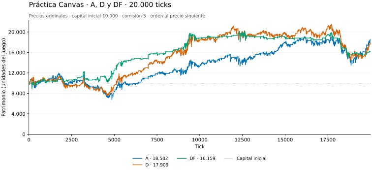
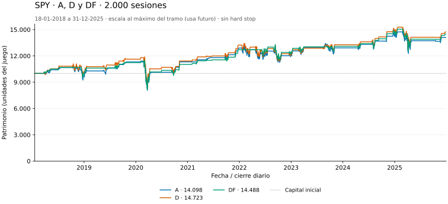
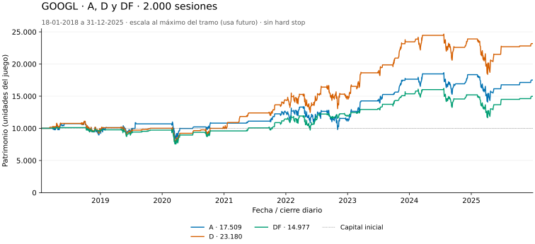
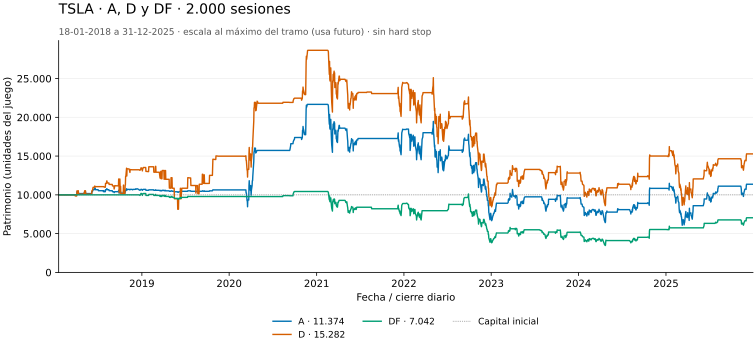
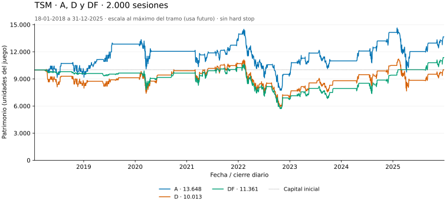
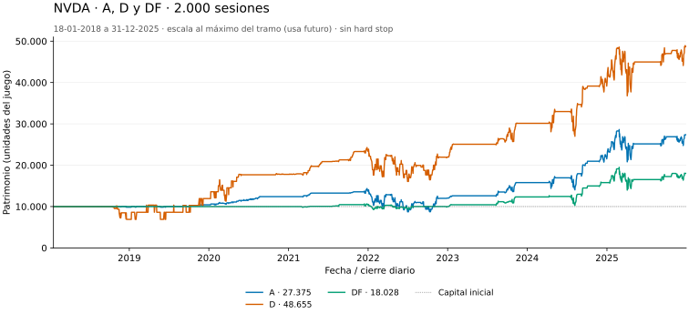
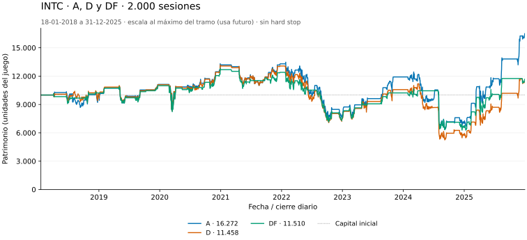
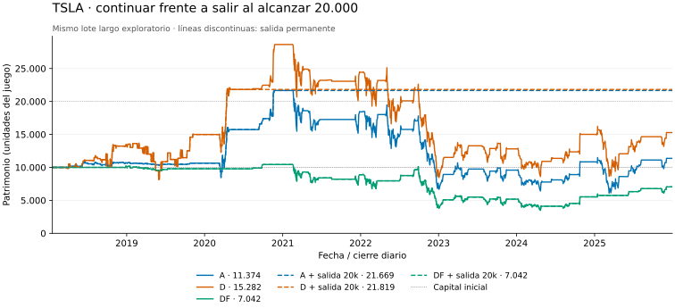
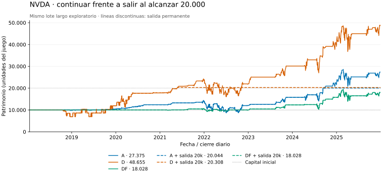

# Decisión pendiente: A, D o DF y salida en patrimonio 20.000

Actualización: 12 de noviembre de 2026. Material de **pre-entrega**, para que el equipo discuta y elija. No se ha fijado estrategia final ni modificado el programa de la placa: el assembly bursátil sigue pendiente. Las referencias Python y su contabilidad no demuestran cumplimiento de los deadlines de Espino.

## Recomendación para la reunión

**Si hay que fijar una base provisional hoy, recomiendo A.** Es la mejor de estas tres en la práctica completa de Canvas y opera bastante menos que D en esa serie. Mantendría **D como alternativa para buscar el máximo patrimonio**, especialmente si se confirman series con retrocesos recuperables y oscilaciones aprovechables. No seleccionaría DF únicamente porque contiene un filtro: sus resultados muestran que no es protección universal.

Esta preferencia por A es provisional, no una conclusión de que generaliza mejor: la práctica ya se ha visto muchas veces. D gana cuatro de los seis históricos largos, pero ese lote usa una escala calculada con información futura. No usaría ese conteo por sí solo para elegir la versión final. Tampoco sumaría patrimonios de activos distintos como si constituyeran una cartera o seis experimentos independientes.

**No activaría por defecto la salida permanente en 20.000 si el objetivo es maximizar la posición en la competencia.** La dejaría como variante candidata si el equipo prefiere proteger una duplicación del capital, o si el curso confirma un beneficio de puntuación concreto por alcanzar ese monto. El enunciado actual no ofrece tal beneficio. Su efecto depende del recorrido: mejoró Tesla y perjudicó NVIDIA en las pruebas largas que acabamos de ejecutar.

## Qué comparamos exactamente

- **A:** reversión a SMA32, banda fija 2 unidades del precio normalizado.
- **D:** reversión a SMA32, banda fija 1; responde a desviaciones menores.
- **DF:** D con bloqueo de nuevas compras si SMA8 < SMA32. Las ventas siguen siendo las de D: el filtro **no obliga a salir de una posición existente**.
- En las tres, promedio incluye el precio actual, igualdad mantiene, 31 observaciones iniciales sin señal, compra con la caja disponible y venta del inventario en cantidades de hasta 63 por orden. Neutral conserva la posición.
- Caja inicial 10.000, comisión fija 5 por orden efectivamente ejecutada, sin deuda/cortos. La decisión calculada en un tick se ejecuta al precio siguiente. El patrimonio final incluye las acciones restantes; no se fuerza una venta final.

Una señal de compra no significa una orden ejecutada: puede faltar caja. Más órdenes no implica mayor rentabilidad. A y D tienen esencialmente el mismo cálculo de señal, salvo el umbral: A no es intrínsecamente más rápida por tener menos operaciones bursátiles. DF añade el promedio corto y su comparación; sus ciclos reales todavía deben medirse.

## Hallazgos y gráficos

### Práctica Canvas, 20.000 puntos

| Variante | Patrimonio final | Órdenes | Comisiones | Máxima caída absoluta desde un peak |
|---|---:|---:|---:|---:|
| A | 18.502 | 729 | 3.645 | 5.630 |
| D | 17.909 | 1.415 | 7.075 | 7.017 |
| DF | 16.159 | 525 | 2.625 | 5.167 |

D compra y vende ante desvíos más pequeños: en esta práctica su mayor actividad no compensó comisiones y exposición a las caídas. DF redujo actividad y caída frente a D, a costa de patrimonio final. Estas relaciones son observaciones de esta serie, no garantías.



El TB tiene `NTICKS=2000` por defecto; `practica.csv` contiene 20.000 puntos. No son dos versiones contradictorias. En los primeros 2.000, A termina con 10.529, D con 9.923 y DF con 10.723. Un tick es una observación recibida: la frecuencia financiera de la práctica no está identificada.

### Históricos cortos: 502 cierres diarios, 2024–2025

Para comparar dentro de la misma escala, usar el [lote común de nivel 50](../semiconductores_2026-11-12/RESULTADOS.md):

| Activo | A | D | DF |
|---|---:|---:|---:|
| SPY | 11.951 | 11.330 | 10.580 |
| GOOGL | 9.917 | 10.062 | 10.287 |
| TSLA | 12.290 | 12.044 | 12.831 |
| TSM, ADR de TSMC | 11.872 | 12.654 | 13.171 |
| NVDA | 16.237 | 16.448 | 14.304 |
| INTC | 17.093 | 15.483 | 10.613 |

Conversión fija por activo: `round_half_up(50*cierre/máximo_de_2023)`, sin clipping. La constante de conversión utiliza solo el año anterior. El nivel 50 se eligió después de detectar que TSM/NVDA desbordaban la escala anterior de 100, no tras buscar mejores patrimonios. Los primeros resultados con nivel 100 se conservan en [adaptativas](../adaptativas_2026-11-12/RESULTADOS.md); no mezclar números de ambas escalas. La cuantización y las comisiones relativas cambian con la escala.

También se exploraron Ad/Dd, con bandas de 1 y 0,5 desviaciones estándar poblacionales sobre 32 precios. No mostraron una mejora consistente y no se incluyen como finalistas. Sus reglas, resultados y trazas quedan archivados, sin borrar intentos desfavorables.

### Históricos largos: exactamente 2.000 cierres diarios

Mismas fechas comunes para los seis activos: **18-01-2018 a 31-12-2025**. Sin reiniciar caja/inventario entre años. [Informe y datos del lote largo](../historicos_2000_2026-11-12/RESULTADOS.md).

**Límite importante:** para alojar todo el recorrido de ocho años en 1–255 sin saturar, se usó `round_half_up(255*cierre/máximo_del_tramo_completo)` por activo. El máximo incluye el futuro: es una comparación exploratoria de series preparadas para el juego, **no una validación financiera a ciegas ni fuera de muestra**. La señal solo ve el pasado normalizado, pero la preparación de datos sí conoce el futuro y puede cambiar las decisiones. No comparar directamente estos patrimonios con los de nivel 50/100.

El redondeo pierde movimientos pequeños, especialmente en precios antiguos de empresas que crecieron mucho: NVDA repite precio normalizado en 983 de 1.999 transiciones. Se usan cierres del proveedor en una misma base por acción ajustada por splits, sin pagos de dividendos; las unidades contables son las del juego, no dólares reales. Los datos originales y transformados están archivados.

| Activo | A | D | DF | Mayor patrimonio entre las tres |
|---|---:|---:|---:|---|
| SPY | 14.098 | 14.723 | 14.488 | D |
| GOOGL | 17.509 | 23.180 | 14.977 | D |
| TSLA | 11.374 | 15.282 | 7.042 | D |
| TSM | 13.648 | 10.013 | 11.361 | A |
| NVDA | 27.375 | 48.655 | 18.028 | D |
| INTC | 16.272 | 11.458 | 11.510 | A |

Las caídas también importan: D/TSLA cae hasta **20.186 unidades desde un peak** antes del final. DF reduce esa caída a 6.969, pero termina perdiendo dinero. Una menor caída absoluta puede coexistir con un peor patrimonio final y con menor participación en las subidas. Ver las métricas completas en los CSV; la caída se mide en unidades, no en porcentaje.








Las escalas verticales de los gráficos se ajustan a cada activo: comparar los valores de los ejes, no solo la altura visual de las curvas. Cada archivo SVG tiene también una copia PNG en la misma carpeta.

## Qué estrategia consideraría bajo cada escenario

| Información nueva del curso / escenario | Preferencia provisional | Motivo y condición |
|---|---|---|
| Sin información adicional fiable | A como base; conservar D como alternativa | A gana en la práctica completa y es menos sensible a desvíos pequeños. No confundir esto con evidencia de generalización. |
| Oscilaciones alrededor de una media relativamente estable, con recuperaciones frecuentes | A; D si la banda 1 deja suficiente margen neto de comisión | Es el supuesto de reversión. D aprovecha más movimientos pequeños, pero también paga más órdenes; comprobar con la escala y comisión reales. |
| Tendencia alcista con retrocesos recuperables y oportunidades repetidas | D como candidata para maximizar patrimonio | Destaca en varios históricos largos; puede comprar más desvíos. Las pruebas largas tienen el límite de normalización señalado. Una tendencia alcista por sí sola no basta para elegirla. |
| Subida casi continua, con pocos retrocesos | Ninguna de las tres queda automáticamente favorecida | Las tres pueden vender pronto y perder la continuación de la subida. Comparar con comprar y mantener; no proclamar D ganadora solo porque el mercado es alcista. |
| Caídas cortas dentro de una recuperación; preocupa no seguir comprando mientras cae | Evaluar DF contra A y D en ese escenario concreto | El filtro bloquea ciertas compras. En TSM/TSLA 2024–2025 ayuda respecto de D, pero en otros tramos perjudica. No es un stop-loss ni una liquidación de riesgo. |
| Mercado bajista prolongado o ruptura sin recuperación | No hay candidata demostrada como segura | A/D pueden comprar demasiado pronto; DF puede seguir atrapada en inventario previo. No se puede ganar apostando a una baja mediante cortos. No prometer que DF resuelve esto. |
| Deadline muy exigente | A o D como punto de partida de implementación; medir las tres | A/D comparten el cálculo principal. La selección debe incluir ciclos, memoria y equivalencia de decisiones, no solo patrimonio Python. |

La banda está en unidades del byte, no en porcentaje. Antes de cambiar la estrategia por una descripción como “no bajista”, necesitamos saber cómo se preparan los precios: la escala, frecuencia y comisiones pueden alterar qué señales se producen. Confirmar un régimen de mercado no garantiza rentabilidad.

## Qué se puede sostener sobre lo dicho en clase

Se revisó la transcripción de Granola `Clase AC 11-11 transcript.txt`, proporcionada por el usuario. Tiene errores importantes, por lo que no se presenta como acta literal ni se publica completa.

- En el intercambio inicial, el docente alude a datos reales, a una empresa como Google y a reproducir/comprimir precios en el tiempo. Esto orienta a probar acciones reales, pero no identifica la procedencia de `practica.csv`, ticker, fechas, frecuencia o normalización de la serie final.
- Un estudiante pregunta por una tendencia generalmente alcista y discute mercados laterales/bajistas. **No se distingue una respuesta fiable que garantice “mercado no bajista”**. Hay alusiones ambiguas a mercados bajistas en la respuesta transcrita. No usar la pregunta del estudiante como compromiso del profesor.
- En el intercambio sobre patrimonio, se contempla llevar una copia local. El [enunciado, §2.4](../../../material/enunciado/Proyecto_4_arq.pdf) sí dice que la maestra lleva la contabilidad oficial y el grupo puede mantener su copia.
- El documento escrito exige series ocultas y el mismo programa para todas ellas (§2.5). No se debe elegir manualmente otra estrategia después de reconocer la serie de una ronda.

Preguntas concretas para confirmar con el curso: (1) si se excluyen o incluyen tramos bajistas; (2) ticker/frecuencia y duración de mercado representada por un tick; (3) regla de conversión a 1–255 y redondeos; (4) capital/comisión definitivos; (5) número de ticks y mecanismo de reinicio por ronda. Comprimir la reproducción en SPI no añade observaciones financieras nuevas.

## Vender todo al alcanzar patrimonio 20.000

La idea protege una duplicación observada del capital, pero reduce la participación en subidas posteriores. Es una elección de riesgo; no hay un monto 20.000 especialmente favorecido por el enunciado. La competencia (§3.4) premia patrimonio final relativo al benchmark y a los otros grupos: quedarse con 20.000 no asegura una posición ni una nota determinada.

Ahora **se simuló de verdad**, sin inferir el resultado de mirar un peak. Regla exacta:

1. Después de ejecutar la orden pendiente al precio recibido, calcular patrimonio local `caja + acciones*precio`.
2. Si es **>=20.000**, activar una bandera permanente de salida.
3. Desde esa decisión, enviar ventas de hasta 63 acciones por tick; se ejecutan al precio siguiente. Continuar liquidando aunque cambie el precio.
4. Una vez sin acciones, mantener caja para siempre. Si nunca alcanza el umbral, continuar con A/D/DF sin cambios.

No garantiza cobrar 20.000: hay desfase, límite de cantidad y comisiones; si se activa al final puede quedar inventario sin vender. La implementación futura requeriría contabilidad local exacta y cálculo de patrimonio dentro del deadline. Por ahora existe solo como referencia Python, no como cambio al programa de la FPGA.

### Resultados donde se activó

| Serie | Base | Continuar | Salida 20k | Diferencia al final |
|---|---|---:|---:|---:|
| TB completo | D | 17.909 | 19.902 | +1.993 |
| TB completo | DF | 16.159 | 20.050 | +3.891 |
| GOOGL largo | D | 23.180 | 20.216 | −2.964 |
| TSLA largo | A | 11.374 | 21.669 | +10.295 |
| TSLA largo | D | 15.282 | 21.819 | +6.537 |
| NVDA largo | A | 27.375 | 20.044 | −7.331 |
| NVDA largo | D | 48.655 | 20.308 | −28.347 |

En el resto de las combinaciones del TB completo y las seis series largas no se alcanzó el objetivo: las trazas y el resultado son idénticos a la base. En particular, DF no alcanza 20.000 en Tesla o NVIDIA. No atribuirle una mejora hipotética por una venta que nunca podría activar.

La observación del usuario se confirma **para A/D en estos históricos concretos**: la salida ayuda mucho en Tesla y perjudica NVIDIA. En D/NVDA activa ya en mayo de 2021 y pierde años posteriores de oportunidades; en A/D de Tesla evita devolver parte importante de un patrimonio ya alcanzado. Son efectos retrospectivos de estas series; no permiten reconocer el futuro cuando se llega a 20.000.




**Mi recomendación:** conservar la salida como opción explícita para discutir, sin hacerla regla final todavía. Si se busca maximizar patrimonio/ranking y se toleran retrocesos grandes, preferiría continuar con la estrategia escogida. Si el equipo prioriza no devolver una duplicación observada, aceptando perder subidas posteriores y sin garantía exacta de caja, puede elegir la salida. “Mercado no bajista” por sí solo no decide: puede haber una caída fuerte después de tocar 20.000 aunque el período entero termine alcista. No se puede decidir retrospectivamente salir solo en Tesla y continuar solo en NVIDIA; debe ser la misma regla causal para todas las series.

Una salida ligada a retroceso del patrimonio desde su máximo sería otra hipótesis para estudiar si se busca proteger ganancias conservando parte de la subida. No se probó en este lote y no se afirma que mejore el resultado; añadir porcentajes/esperas también abre más posibilidades de sobreajuste.

## Datos, validación y reproducción

- [Guía histórica completa de estrategias](../../../README_ESTRATEGIAS.md): conserva familias iniciales, A–E, protecciones y variantes descartadas.
- [Lote adaptativas y primeros históricos](../adaptativas_2026-11-12/RESULTADOS.md): datos originales JSON, precios, decisiones por tick y configuraciones.
- [Seis activos, 502 sesiones a nivel 50](../semiconductores_2026-11-12/RESULTADOS.md).
- [Seis activos, 2.000 sesiones](../historicos_2000_2026-11-12/RESULTADOS.md).
- [Salida en 20.000: 42 corridas y resultados completos](../salida_20000_2026-11-12/RESULTADOS.md).

Los directorios incluyen `resumen.csv`, `configuracion.json`, fuentes/hashes, trazas por tick y `validacion_contabilidad.json`. Las trazas tienen precio, decisiones aplicada/siguiente, compras/ventas efectivas, caja, inventario, patrimonio, órdenes, comisiones y drawdown. Los históricos reales incluyen fecha. Los JSON originales de Yahoo permiten repetir la normalización sin depender de una descarga futura.

La contabilidad se contrasta con la tarea `ejecutar` copiada del TB de Canvas, no con una segunda fórmula Python. Lote adaptativo: 141.056 ticks; lote común corto: 9.056; lote largo: 36.020; prueba de salida: 192.020. Las pruebas de salida comprueban activación por patrimonio, desfase, liquidación por tramos, permanencia en caja, falta de garantía del umbral y equivalencia exacta cuando no se alcanza. Esto no demuestra calidad predictiva ni velocidad de Espino.

Desde la raíz de `pre-entrega`, con Python 3.10+ e Icarus Verilog (`iverilog`, `vvp`):

```sh
python3 -B -m unittest discover -s tests -v
python3 tools/compare_adaptive.py
python3 tools/compare_semiconductors.py
python3 tools/compare_long_history.py
python3 tools/compare_target_exit.py
```

Para regenerar los nueve gráficos publicados, instalar la dependencia opcional de gráficos en un entorno propio y ejecutar:

```sh
python3 -m pip install -r requirements-plots.txt
python3 tools/plot_findings.py
```

Se generan SVG y PNG en `docs/estrategia/recomendacion_2026-11-12/graficos/`. Los gráficos usan todas las observaciones de sus trazas, no solo los puntos reducidos que se mostraron dentro de la conversación. No requieren conexión a internet ni programan la placa. No se agregaron datos bursátiles precargados al diseño de la FPGA.
