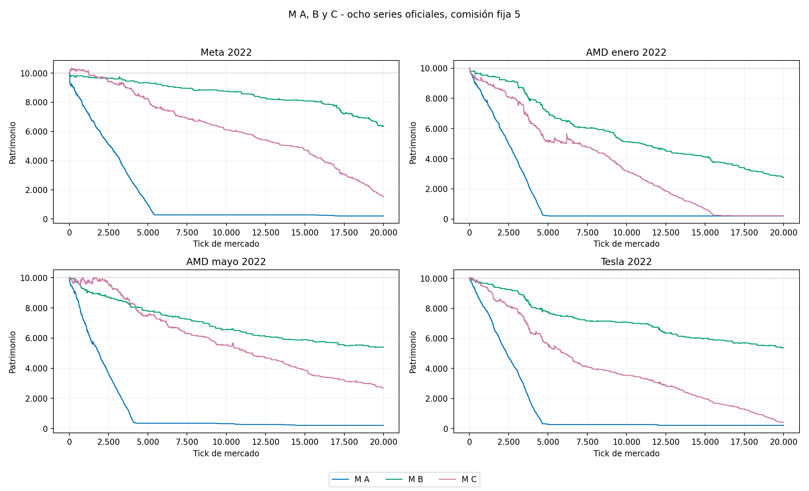
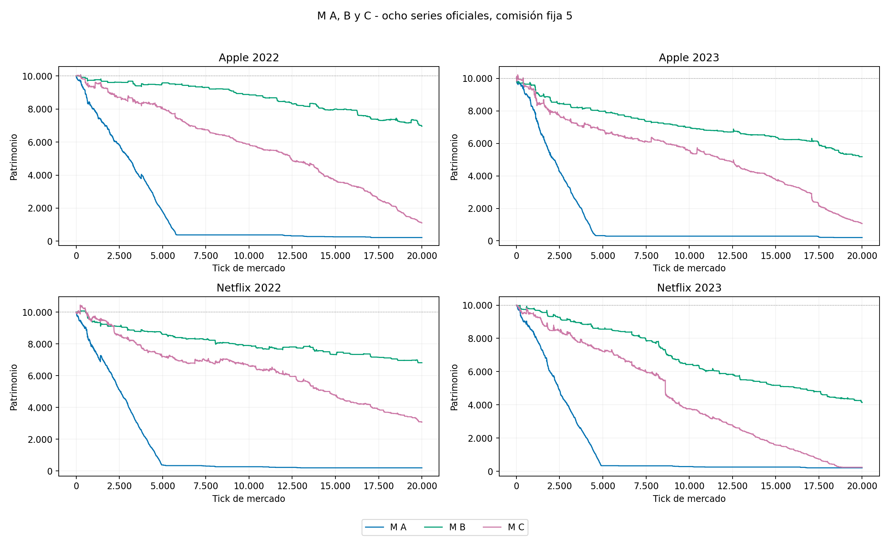
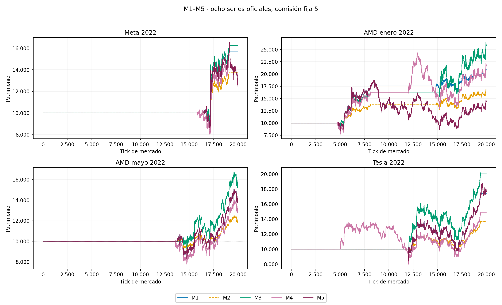
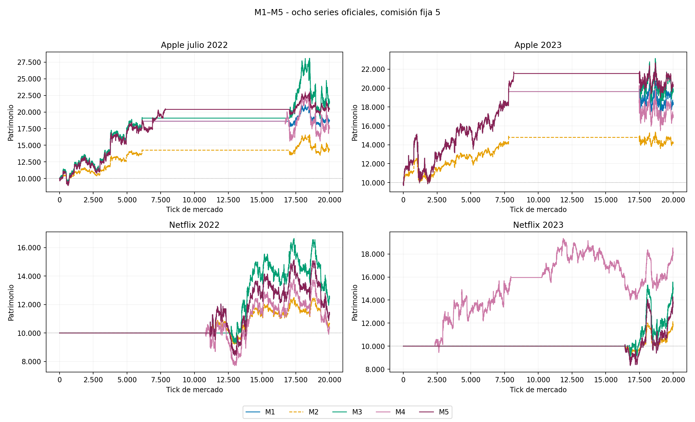

# Reporte M

**Actualización 24/11: el equipo eligió M105-225.** El contraste posterior de cuatro finalistas sobre 78 series ya se completó. [Decisión, fundamento, datos y PDF](../seleccion_M105_225_2026-11-24/README.md). Las secciones siguientes conservan los resultados y el estado histórico del 23/11; el siguiente trabajo vigente es incorporar la elegida y validarla en Espino y FPGA.

Actualización del 23 de noviembre de 2026. Se conserva el recorrido desde M A/B/C y M1–M5 hasta el ajuste de bandas M X-Y. La comparación vigente es la [malla de 15 candidatas sobre ocho series oficiales](malla_15/README.md): **120 corridas**, ocho gráficos con patrimonio final en cada leyenda, resultados, comisiones, caídas, código y trazas reproducibles. **M105-220 lidera esa muestra con media $19.453,625**; no se ha elegido una estrategia definitiva.

El [ajuste anterior de X y luego Y](ajuste_xy/README.md) dejó como referencia M110-220 antes de ampliar la grilla. Las tablas de M1–M5 siguientes conservan la historia de su propio lote: M3 lideró ese lote, no la comparación actual.

Todas son simulaciones Python sobre series conocidas. La evaluación de las candidatas actuales en las 70 recreadas está pendiente. La estrategia de la FPGA no se cambió. [Contexto para continuar](SIGUIENTE_PASO.md).

## Reglas y datos comunes

Cada corrida reinicia con caja 10.000 e inventario cero. La comisión sigue siendo **5 por orden ejecutada**, tanto al comprar como al vender. Cada orden permite hasta 63 acciones; se recorta por caja o inventario disponible. No hay deuda ni cortos. Una decisión tomada con el precio del tick actual **se ejecuta al precio siguiente**.

El patrimonio es caja más acciones valorizadas al precio actual. **No se fuerza una venta al terminar:** un resultado final favorable puede incluir acciones todavía en cartera. Los símbolos `$` de las tablas representan unidades del simulador.

Se usaron exclusivamente los ocho CSV de `Proyecto 4 Series Practica`, con 20.000 precios por archivo. Se conservan copias exactas en [datos/oficiales](datos/oficiales/). Los precios no se renormalizaron ni se reconstruyeron para estas corridas; son entradas del curso con rango 100-255. El año o mes del nombre identifica el tramo, pero sus 20.000 minutos pueden extenderse a meses posteriores. Meta corresponde al mismo contenido de `practica_meta.csv`, sin contarlo dos veces. La práctica original anterior y los CSV recreados no forman parte de estos resultados.

## Primera iteración M A B C

La hipótesis fue capturar oscilaciones breves respetando el retraso de ejecución. Compra después de una subida observada y vende tras un plazo corto. La salida por tiempo aísla esa hipótesis: no hay TP, stop loss ni trailing.

La exposición al dimensionar cada entrada se limita al 50 % del patrimonio observado, con una sola compra por posición y máximo 63 acciones. No hay espera adicional después de vender. Los umbrales son unidades enteras de precio normalizado y la comparación es inclusiva: `precio_actual - precio_de_hace_L_ticks >= umbral`.

Si la compra se ejecuta en el tick `t`, la venta se ejecuta en `t + duración`. Para duración 1, se emite la venta en el mismo tick en que se confirma la compra y se ejecuta al siguiente; no se usan precios futuros para decidir.

| Versión | Mira atrás | Subida mínima | Duración de posición | Promedio final | Comisión media | Casos sobre 10.000 |
|---|---|---|---|---|---|---|
| M A | 1 tick | 1 unidad | 1 tick | $ 207,12 | $ 9.470,00 | 0/8 |
| M B | 1 tick | 2 unidades | 1 tick | $ 5.369,88 | $ 4.203,75 | 0/8 |
| M C | 4 ticks | 2 unidades | 4 ticks | $ 1.292,50 | $ 8.315,00 | 0/8 |

### Patrimonio final de la primera iteración

| Serie | M A | M B | M C |
|---|---|---|---|
| Meta 2022 | $ 205 | $ 6.342 | $ 1.520 |
| AMD enero 2022 | $ 206 | $ 2.757 | $ 222 |
| AMD mayo 2022 | $ 207 | $ 5.396 | $ 2.689 |
| Tesla 2022 | $ 210 | $ 5.372 | $ 418 |
| Apple julio 2022 | $ 221 | $ 6.956 | $ 1.109 |
| Apple 2023 | $ 203 | $ 5.178 | $ 1.065 |
| Netflix 2022 | $ 199 | $ 6.812 | $ 3.077 |
| Netflix 2023 | $ 206 | $ 4.146 | $ 240 |

Las 24 corridas perdieron. M A pagó 9.470 de comisión media; B, 4.203,75; C, 8.315. El movimiento de precios también aportó pérdidas en promedio en estas trayectorias: no fue una ventaja que simplemente quedara oculta por las comisiones. Esta prueba descartó esas tres configuraciones, no todas las posibles estrategias de corto plazo.





Código: [m.py](corto/tools/m.py). Resultados exactos: [resumen.csv](corto/resumen.csv), [agregados.json](corto/agregados.json). Configuración previa a las corridas: [plan.json](corto/plan.json).

## Motivación y desarrollo de M

Los mejores resultados observados en la práctica nos impulsaron a no conformarnos con el desempeño inicial y seguir investigando. M es un desarrollo propio del equipo: sus reglas, implementación y experimentos se trabajaron con los datos y el modelo de mercado del proyecto.

El rango conocido 100-255 y las comparaciones de la práctica llevaron a explorar bandas de compra y venta separadas, períodos de espera en caja y una mayor exposición. Invertir casi toda la caja durante una recuperación amplia puede producir una ganancia grande con pocas órdenes. Esa hipótesis se evaluó con las reglas contables del curso y quedó definida en las cinco configuraciones siguientes.

## Segunda iteración M1 a M5

Las cinco configuraciones se fijaron antes de correrlas. Se mantuvo la misma regla en las ocho acciones y períodos, sin escoger una versión distinta según el activo. Se cambió el límite bajo, el alto o la exposición respecto de M1.

| Versión | Compra hasta | Venta desde | Exposición | Promedio final | Peor final | Comisión media | Mayor caída |
|---|---|---|---|---|---|---|---|
| M1 | 120 | 210 | 100 % | $ 16.233,75 | $ 11.286 | $ 18,125 | 34,8 % |
| M2 | 120 | 210 | 50 % | $ 13.374,62 | $ 10.610 | $ 10,625 | 20,9 % |
| M3 | 110 | 210 | 100 % | $ 18.283,62 | $ 12.411 | $ 19,375 | 34,8 % |
| M4 | 130 | 210 | 100 % | $ 15.957,25 | $ 10.294 | $ 20,625 | 46,8 % |
| M5 | 120 | 230 | 100 % | $ 15.517,00 | $ 11.286 | $ 14,375 | 54,1 % |

### Funcionamiento exacto de las bandas

1. **Espera en caja.** Emite una compra cuando el precio observado es menor o igual al límite de compra. En ese instante fija un presupuesto para esa campaña: exposición por patrimonio observado, incluyendo los costos de adquisición.
2. **Acumula dentro de la banda.** Solicita hasta 63 acciones por tick, limitado por caja y presupuesto restante después de una comisión. Las compras se contabilizan al precio de ejecución real del tick siguiente. Puede usar varias órdenes para invertir casi toda la caja. Cuando el precio sale de la banda o el presupuesto restante no alcanza para otra acción y su comisión, deja de agregar compras y mantiene la posición.
3. **Mantiene.** No sale por oscilaciones pequeñas, no usa stop o trailing separados y no retira fondos al llegar a 20.000 o 30.000 de patrimonio. Si el precio vuelve a la zona barata mientras mantiene esa posición, no reinicia la acumulación ya cerrada.
4. **Liquida por precio.** Cuando el precio observado alcanza o supera la banda alta, comienza a vender. La salida queda enclavada: termina de vender todo en órdenes de hasta 63 aunque el precio retroceda bajo la banda durante la liquidación. Cada orden paga comisión.
5. **Espera una nueva entrada.** Al quedar sin acciones, mantiene caja hasta otra llegada a la banda baja. Puede iniciar una nueva campaña; no hay retiro permanente.

El presupuesto se calcula al decidir. Un salto en el precio de ejecución puede exceder el porcentaje observado, especialmente en la versión de 50 %. La caja real siempre limita el llenado de la orden. Si nunca vuelve a alcanzarse la banda de venta, la posición queda abierta hasta el último precio del archivo.

### Patrimonio final de las bandas

| Serie | M1 | M2 | M3 | M4 | M5 |
|---|---|---|---|---|---|
| Meta 2022 | $ 15.723 | $ 13.721 | $ 16.227 | $ 15.093 | $ 12.452 |
| AMD enero 2022 | $ 20.824 | $ 16.680 | $ 25.874 | $ 21.693 | $ 14.409 |
| AMD mayo 2022 | $ 13.808 | $ 11.881 | $ 15.326 | $ 12.853 | $ 13.808 |
| Tesla 2022 | $ 17.430 | $ 13.680 | $ 20.123 | $ 14.841 | $ 17.689 |
| Apple julio 2022 | $ 18.734 | $ 14.371 | $ 21.627 | $ 17.757 | $ 20.514 |
| Apple 2023 | $ 18.360 | $ 14.214 | $ 19.741 | $ 17.032 | $ 20.273 |
| Netflix 2022 | $ 11.286 | $ 10.610 | $ 12.411 | $ 10.294 | $ 11.286 |
| Netflix 2023 | $ 13.705 | $ 11.840 | $ 14.940 | $ 18.095 | $ 13.705 |

Las 40 corridas terminaron sobre 10.000. M3 tuvo el mejor promedio y un peor patrimonio final de 12.411, pero también soportó caídas desde máximos de hasta 34,8 %. M5 alcanzó una caída máxima del 54,1 %: una venta objetivo más alta puede dejar ganancias sin realizar durante bastante tiempo.





Código: [m_bands.py](bandas/tools/m_bands.py). Resultados exactos: [resumen.csv](bandas/resumen.csv), [agregados.json](bandas/agregados.json). Configuración previa: [plan.json](bandas/plan.json).

## Reproducción y verificación

Requiere Python 3.10+, Matplotlib e Icarus Verilog (`iverilog` y `vvp`). Se probó con Python 3.10.2 y Matplotlib 3.10.9. El archivo [requirements.txt](requirements.txt) fija la versión de gráficos utilizada. No se requiere FPGA ni acceso a proveedores de precios.

Desde esta carpeta:

```sh
python3 -m pip install -r requirements.txt
cd corto
python3 -B tools/check_m.py
python3 -B tools/compare_m.py
cd ../bandas
python3 -B tools/check_bands.py
python3 -B tools/compare_bands.py
```

Para comparar otra vez todos los campos numéricos contra las trazas publicadas, sin regenerar figuras, ejecutar desde esta carpeta:

```sh
python3 -B verificar_trazas.py corto
python3 -B verificar_trazas.py bandas
```

Los programas usan los ocho archivos locales en `../datos/oficiales`, regeneran CSV, gráficos y validación, y no descargan datos. No programan la placa. Las rutas y las etiquetas se adaptaron a la publicación y a la nomenclatura M; las reglas bursátiles, las decisiones y los resultados numéricos se conservaron. [corto/ORIGEN.json](corto/ORIGEN.json) y [bandas/ORIGEN.json](bandas/ORIGEN.json) registran la revisión base y los hashes de las fuentes y trazas publicadas.

Las decisiones se reprodujeron con la tarea de contabilidad extraída del testbench original, conservado en el `tb/` de cada etapa:

- **M A/B/C:** PASS en 480.160 ticks de verificación, incluidas las pruebas de borde.
- **M1–M5:** PASS en 800.160 ticks de verificación, incluidas las pruebas de borde.
- Las pruebas pequeñas verifican ejecución al precio siguiente, cantidades reales, comisiones, ausencia de liquidación final y que agregar precios futuros no cambie decisiones anteriores.
- En bandas también se verifican varias órdenes de compra/venta, liquidación enclavada y tramos de caja plana.

Estas comprobaciones validan contabilidad y causalidad de Python. No son ejecución en Espino ni mediciones de plazos SPI del nuevo algoritmo. La imagen de la FPGA y `Desarrollo AC4` no se modificaron.

Las trazas publicadas están comprimidas para evitar decenas de megabytes de CSV repetitivos:

- [corto/trazas_csv.tar.gz](corto/trazas_csv.tar.gz): decisiones, llenados, caja, acciones, patrimonio, estado de la política, operaciones cerradas y validación por serie de A/B/C.
- [bandas/trazas_csv.tar.gz](bandas/trazas_csv.tar.gz): los mismos datos para 1/2/3/4/5.

Cada archivo se extrae dentro de su propia carpeta y crea `resultados/`. Sus hashes están en `ORIGEN.json`; los gráficos individuales y los resúmenes se consultan directamente en GitHub.

## Datos exactos de las ocho entradas

| Archivo oficial | Precios | SHA256 |
|---|---|---|
| practica_meta_2022.csv | 20000 | `fed122e0a9861276d76b1396b264fd34077c280c80fe6b356b6971d55242da3f` |
| practica_amd_2022_ene.csv | 20000 | `0c1c5e791578a59ec0f077d263f6103a4d1fde8e0f8ffbe1e775c05f442a0bc7` |
| practica_amd_2022_may.csv | 20000 | `20e2ead37cdeb3ba0d38c4feba9f0b606665f277bde8214e1c7fdb6d92a69a2a` |
| practica_tesla_2022.csv | 20000 | `a48617cc5a91023f16731d24f86814204bdad9d48367d7559c0c6fac6bfd7db6` |
| practica_apple_2022.csv | 20000 | `0c28c0a53f6fd55ee6216916c1d7d529a5998bbe7ad4d8f940e439d78fe2dbb8` |
| practica_apple_2023.csv | 20000 | `6a28f5a36754f82cf17187100a5d1e55554ebc17b6c40528167e8525d16fa675` |
| practica_netflix_2022.csv | 20000 | `71e96fc05c3dca67e30d27a8baf8cbef39d0186a385ebf3e9a719ab1bef19846` |
| practica_netflix_2023.csv | 20000 | `30b59beaa67efe60949fa00f020a3f38981fa72aa4d2ccb1a7230a03de214bcd` |

## Próximo paso pendiente

Evaluar las candidatas actuales M X-Y sobre las series recreadas antes de cerrar la elección. La grilla vigente y sus parámetros están en [malla_15/README.md](malla_15/README.md); no confundirla con las cinco M1–M5 históricas. El equipo prevé escoger una de estas candidatas, pero todavía no confirmó cuál. Las ocho oficiales se usaron para ajustar bandas; 8/8 positivos no equivale a validación independiente.

El contexto está en [SIGUIENTE_PASO.md](SIGUIENTE_PASO.md). Esta publicación documenta lo ya realizado; no ejecuta la evaluación pendiente ni modifica la placa.
