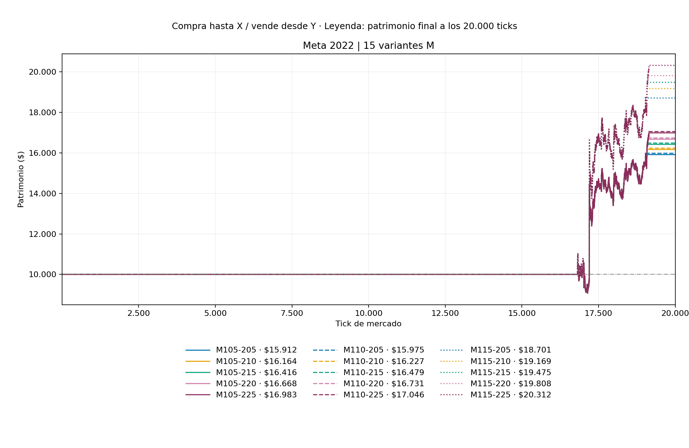
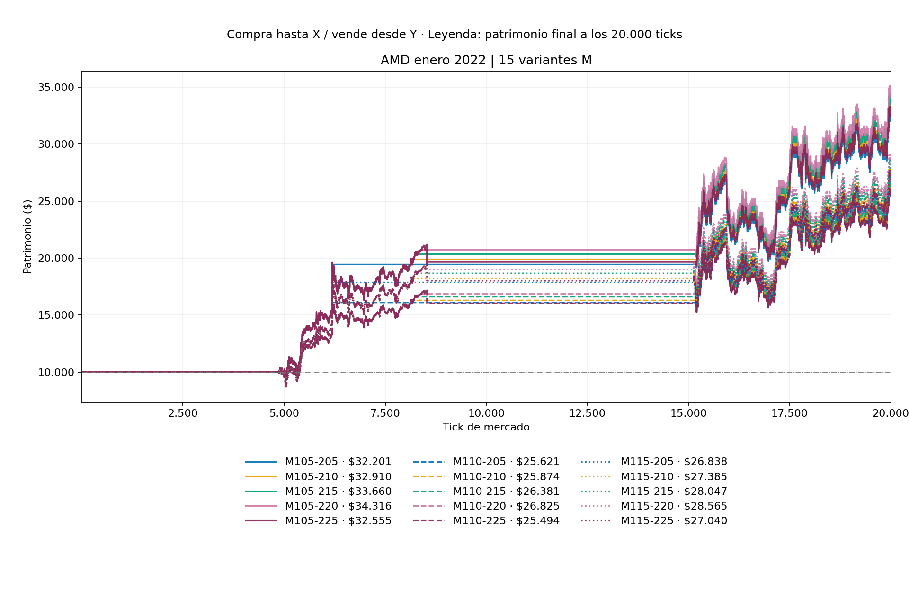
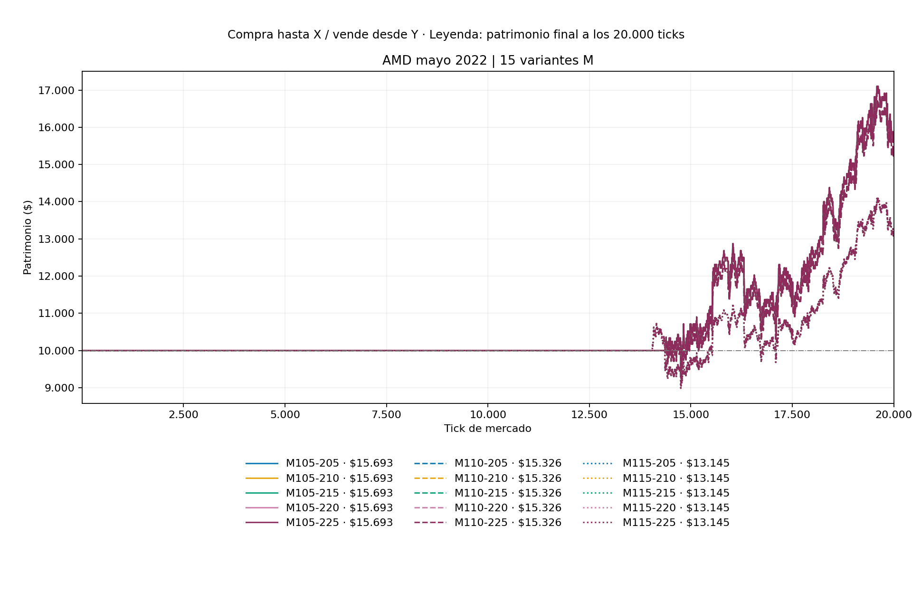
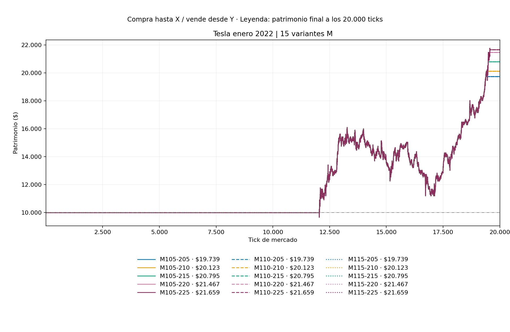
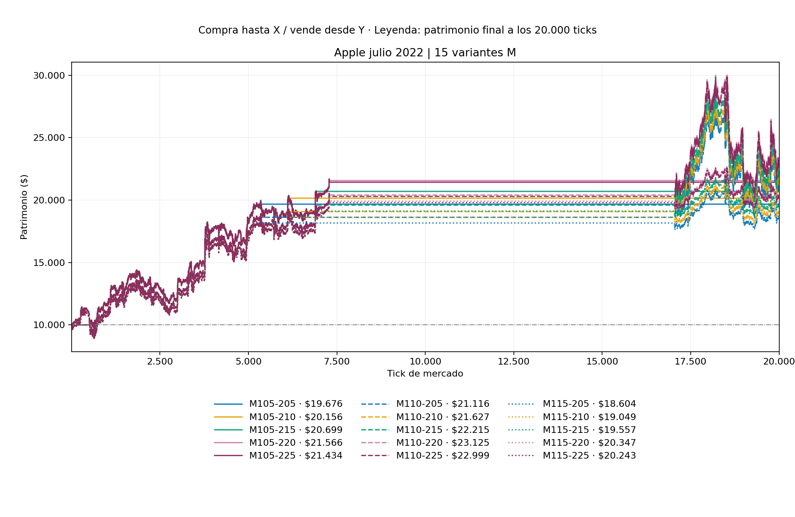
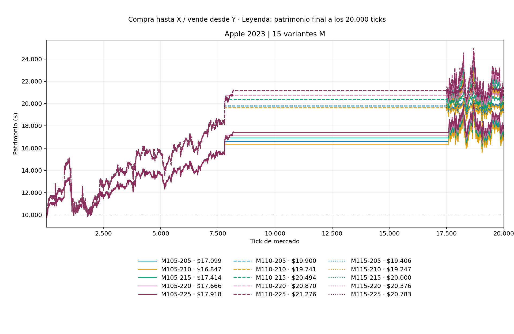
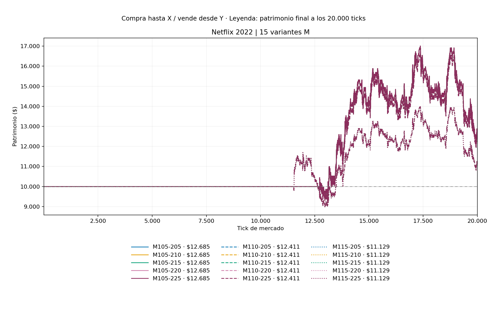
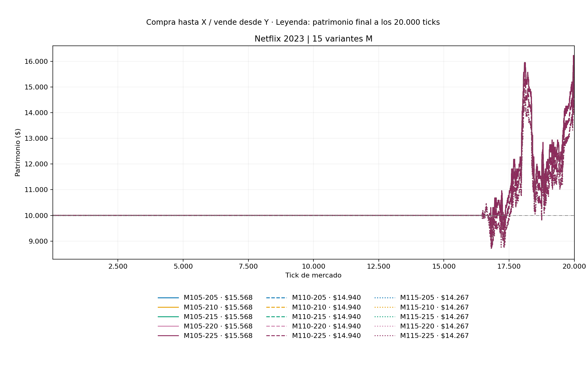

# M X-Y: 15 candidatas sobre las ocho series oficiales

**Actualización 24/11: se eligió M105-225 tras el contraste posterior sobre 78 series.** [Decisión y reporte vigente](../../seleccion_M105_225_2026-11-24/README.md). Este documento conserva la comparación previa de 15 variantes en ocho oficiales; sus referencias a una selección pendiente corresponden a esa etapa.

Experimento del 23/11/2026. Se compararon **120 corridas: 15 configuraciones por ocho CSV oficiales**, cada una de 20.000 ticks. Se conservaron las reglas de bandas de M, el presupuesto del 100 % y las reglas contables del curso. Se variaron únicamente X = 105, 110, 115 y Y = 205, 210, 215, 220, 225. La grilla se fijó antes de observar estos resultados.

**M X-Y** significa comprar con precio observado menor o igual a X y comenzar a liquidar con precio mayor o igual a Y. Todas usan el mismo algoritmo: acumular dentro de la banda baja en órdenes de hasta 63; dejar de acumular al salir de ella o agotar presupuesto; mantener; liquidar completamente en órdenes de hasta 63 al alcanzar la banda alta; esperar otra entrada. No hay stop de patrimonio, stop loss separado ni retiro permanente. La salida queda enclavada aunque el precio baje de Y durante la venta. El detalle completo está en [las reglas de M](../README.md#funcionamiento-exacto-de-las-bandas).

## Resultado y estado de la elección

**M105-220 obtuvo la mayor media final: $19.453,625**, frente a $18.961,875 de M110-220, líder de la iteración anterior: mejora de $491,75 por serie en promedio. Sus ocho resultados superan el capital inicial; su peor final es $12.685, la comisión media es $17,50 y la mayor caída porcentual desde un pico alcanza el 33,02 %. Las 15 variantes terminaron sobre 10.000 en las ocho series.

El equipo prevé elegir su estrategia definitiva entre estas variantes, pero **todavía no ha seleccionado una**. M105-220 es la líder descriptiva de esta muestra, no una decisión de entrega ni una garantía sobre períodos nuevos. Las ocho series son conocidas y se reutilizaron para ajustar parámetros. El siguiente contraste pendiente es sobre las series recreadas; no fue ejecutado por esta publicación. Los fondos aún invertidos se valorizan al último precio: patrimonio final no significa que todo sea caja asegurada.

## Media final de cada combinación

Se da el mismo peso a cada serie. Capital inicial de cada corrida: 10.000. La media se muestra con dos decimales; los CSV conservan los valores originales.

| Compra hasta X / vende desde Y | 205 | 210 | 215 | 220 | 225 |
|---|---:|---:|---:|---:|---:|
| 105 | $18.571,62 | $18.768,25 | $19.116,25 | $19.453,62 | $19.311,88 |
| 110 | $18.128,50 | $18.283,62 | $18.630,12 | $18.961,88 | $18.893,88 |
| 115 | $17.728,62 | $17.939,25 | $18.301,88 | $18.638,00 | $18.572,25 |

## Ranking y riesgo

La caída se calcula como el mayor descenso porcentual desde un pico previo de patrimonio dentro de una corrida; se muestra el peor de los ocho casos. La comisión media incluye todos los pagos de compra y venta de cada corrida. Las comisiones ya están descontadas del patrimonio.

| Variante | Media final | Peor final | Series sobre 10.000 | Comisión media | Mayor caída desde un pico |
|---|---:|---:|---:|---:|---:|
| M105-220 | $19.453,62 | $12.685 | 8/8 | $17,500 | 33,02 % |
| M105-225 | $19.311,88 | $12.685 | 8/8 | $16,875 | 33,02 % |
| M105-215 | $19.116,25 | $12.685 | 8/8 | $17,500 | 33,02 % |
| M110-220 | $18.961,88 | $12.411 | 8/8 | $19,375 | 34,79 % |
| M110-225 | $18.893,88 | $12.411 | 8/8 | $20,000 | 34,79 % |
| M105-210 | $18.768,25 | $12.685 | 8/8 | $17,500 | 33,02 % |
| M115-220 | $18.638,00 | $11.129 | 8/8 | $18,125 | 34,79 % |
| M110-215 | $18.630,12 | $12.411 | 8/8 | $19,375 | 34,79 % |
| M115-225 | $18.572,25 | $11.129 | 8/8 | $18,125 | 34,79 % |
| M105-205 | $18.571,62 | $12.685 | 8/8 | $16,875 | 33,02 % |
| M115-215 | $18.301,88 | $11.129 | 8/8 | $18,125 | 34,79 % |
| M110-210 | $18.283,62 | $12.411 | 8/8 | $19,375 | 34,79 % |
| M110-205 | $18.128,50 | $12.411 | 8/8 | $19,375 | 34,79 % |
| M115-210 | $17.939,25 | $11.129 | 8/8 | $18,125 | 34,79 % |
| M115-205 | $17.728,62 | $11.129 | 8/8 | $18,125 | 34,79 % |

## Ocho gráficos

Cada gráfico contiene las 15 variantes. La leyenda incluye nombre y patrimonio final al tick 20.000. Color = Y (205 azul, 210 naranja, 215 verde, 220 rosado, 225 morado); línea continua = X105, discontinua = X110 y punteada = X115. Curvas idénticas pueden superponerse: por ejemplo, si no se alcanza ninguna banda alta, modificar Y no provoca una venta distinta.

### Meta 2022



### AMD enero 2022



### AMD mayo 2022



### Tesla enero 2022



### Apple julio 2022



### Apple 2023



### Netflix 2022



### Netflix 2023



## Reglas, trazas y reproducción

Caja inicial 10.000, inventario cero; comisión **5 por orden ejecutada**; máximo 63 acciones por orden; ejecución al **precio siguiente**; compras limitadas por caja, ventas por inventario; sin cortos, deuda ni liquidación final forzada. Cada corrida reinicia todo el estado. Las decisiones no usan el nombre del activo, fechas ni precios futuros. Se utilizan directamente los ocho CSV oficiales ya incluidos en [datos/oficiales](../datos/oficiales/), sin reconstrucción ni renormalización.

- [Protocolo y hashes de entrada](protocolo.json).
- [Resultados de las 120 corridas](resumen.csv): patrimonio, caja, inventario, órdenes, comisiones, caída y campañas cerradas.
- [Ranking](ranking.csv) y [agregados exactos](agregados.json).
- [Trazas comprimidas](trazas_csv.tar.gz): `resultados/<serie>/<variante>.csv`, operaciones cerradas y validación contable por serie.
- [Validación de origen](validacion.json): PASS en **2.400.160 ticks**, incluidos 160 casos de borde, contra la tarea contable original del testbench. Las 16 corridas que coincidían con M110-210/M110-220 del experimento anterior también dieron trazas idénticas.
- [Procedencia y hashes de archivos locales](ORIGEN.json).

Requiere Python 3.10+, Matplotlib 3.10.9 y, para regenerar y validar la contabilidad, Icarus Verilog (`iverilog`, `vvp`). Desde esta carpeta:

```sh
# Comprueba que el código publicado reproduzca las 120 trazas, sin regenerar gráficos.
python3 -B verificar_trazas.py
# Regenera las 120 corridas, sus figuras y la validación contable.
python3 -B tools/compare_grid.py
```

La verificación de trazas compara las 12 columnas numéricas de cada tick, estados de la política y resultados contables finales. La adaptación para publicación cambia rutas y elimina la dependencia del experimento local anterior; no modifica las reglas. Los hashes del paquete están en [SHA256SUMS](../SHA256SUMS). No se ejecutó esta estrategia en Espino/RTL, no se midieron sus plazos SPI y no se cambió la FPGA ni `Desarrollo AC4`.
