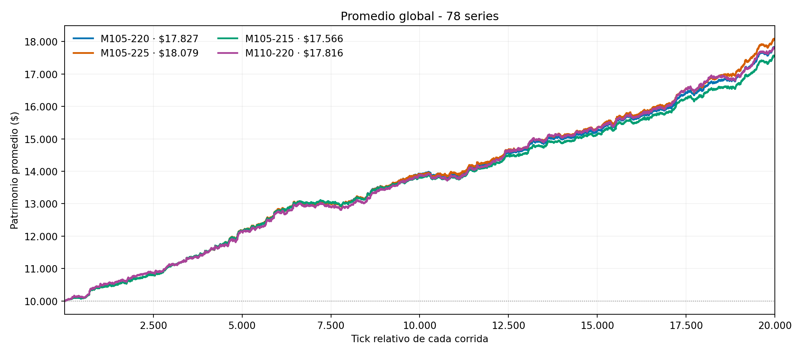

# Decisión del equipo: M105-225

**24 de noviembre de 2026. Elegimos M105-225 como estrategia bursátil definitiva del equipo.** La decisión fue confirmada por Andrés Bowen después de comparar las cuatro finalistas sobre 70 series recreadas y 8 oficiales: 78 entradas, 312 evaluaciones guardadas y 20.000 ticks por corrida.

**Priorizamos el mayor patrimonio promedio entre los períodos y acciones evaluados, aunque la estrategia elegida pueda ser superada en una corrida particular.** No elegimos el mayor máximo aislado. M105-225 obtuvo **$18.079,33 de media**, frente a $17.826,79 de M105-220. Esta última alcanzó **$34.316 en AMD enero 2022**, por encima de los **$32.555 de M105-225** en esa serie. Aceptamos esa diferencia puntual para escoger la alternativa con mejor desempeño medio del conjunto.

La selección del algoritmo queda cerrada; **su incorporación a Espino/RTL y la FPGA sigue pendiente**. Esta publicación documenta y congela la referencia Python. El programa operativo existente continúa siendo D hasta completar y aprobar la transición.

## Justificación de la elección

La primera comparación de las 15 bandas sobre ocho series oficiales favorecía M105-220. Para evitar decidir solo por ese lote conocido, seleccionamos las cuatro finalistas y las enfrentamos a 70 bloques recreados existentes de Meta, Apple, Netflix, AMD y Tesla. Después reunimos las 78 series con el mismo peso por archivo. Se mantuvieron las bandas y reglas durante este contraste; no se buscaron nuevos umbrales después de ver sus resultados.

M105-225 lideró la media sobre las 70 recreadas ($17.938,47) y sobre el conjunto de 78 ($18.079,33). En las ocho oficiales aisladas, M105-220 seguía siendo superior en promedio ($19.453,625 frente a $19.311,875). El conjunto más amplio cambió la prioridad frente al lote oficial por sí solo.

Por eso escogimos M105-225: buscar un comportamiento más general entre los bloques evaluados, en vez de maximizar el resultado de una sola trayectoria. **Que ocasionalmente otra alternativa la supere es compatible con ese criterio.** En estas 78 series tuvo 33 primeros lugares exclusivos, frente a 22 de M110-220, uno de M105-220 y ninguno de M105-215; las demás series tuvieron empates en el primer lugar.

El resultado medio no es una garantía sobre series futuras. Las ocho oficiales se usaron durante el ajuste; algunos períodos recreados pueden coincidir con ellas y los activos comparten fechas. Esta evaluación amplía la cobertura de comparación, pero no demuestra 78 ensayos estadísticamente independientes ni superioridad universal.

| Variante | Media final (78) | Mediana | Mejor final puntual | Peor final | Comisión total (78) | Mayor caída individual |
|---|---:|---:|---:|---:|---:|---:|
| M105-225 | $ 18.079,33 | $ 17.613,00 | $ 32.555 | $ 10.688 | $ 1.155 | 48,63 % |
| M105-220 | $ 17.826,79 | $ 17.424,00 | $ 34.316 | $ 10.688 | $ 1.160 | 48,63 % |
| M110-220 | $ 17.816,46 | $ 19.731,50 | $ 27.787 | $ 10.373 | $ 1.265 | 48,50 % |
| M105-215 | $ 17.565,73 | $ 17.175,50 | $ 33.660 | $ 10.688 | $ 1.160 | 48,63 % |

Las cuatro terminaron sobre 10.000 en las 78 series. Eso no elimina el riesgo dentro de cada corrida: M105-225 soportó una caída desde un pico de hasta 48,63 %. En 33 de las 78 terminó con inventario abierto, por lo que el patrimonio final no representa necesariamente caja asegurada.

M110-220 tuvo una mediana mayor ($19.731,50) y mejor media por activo en Apple y Netflix. Elegimos por **mayor media del conjunto**, no por mejor mediana, menor caída o victoria en cada acción. También pagó menos comisiones la seleccionada: $1.155 en total, frente a $1.160 de M105-220/M105-215 y $1.265 de M110-220. La diferencia media de costos es pequeña y no es la razón principal de la elección. La comisión del mercado sigue siendo 5 por orden ejecutada; nunca se modificó.

## Mismo peso por serie; resultados separados por origen

| Variante | Media 70 recreadas | Media 8 oficiales | Media conjunta 78 |
|---|---:|---:|---:|
| M105-225 | $ 17.938,47 | $ 19.311,88 | $ 18.079,33 |
| M105-220 | $ 17.640,87 | $ 19.453,62 | $ 17.826,79 |
| M110-220 | $ 17.685,56 | $ 18.961,88 | $ 17.816,46 |
| M105-215 | $ 17.388,53 | $ 19.116,25 | $ 17.565,73 |

La media conjunta es `(70 × media_recreadas + 8 × media_oficiales) /78`. No se ponderó 50% por origen ni se encadenaron las cajas entre corridas. Los promedios por acción incorporan sus 14 recreadas y una o dos oficiales:

| Acción | Series | Media M105-225 | Mayor media entre las cuatro |
|---|---:|---:|---|
| Meta | 15 | $ 19.036,73 | M105-225 |
| Apple | 16 | $ 17.056,00 | M110-220 |
| Netflix | 16 | $ 17.702,25 | M110-220 |
| AMD | 16 | $ 19.095,25 | M105-225 |
| Tesla | 15 | $ 17.532,07 | M105-225 |

## Comparación con la fila 3 de la práctica

| Serie oficial | Fila 3 reportada en clase | M105-225 simulada | Diferencia |
|---|---:|---:|---:|
| Tesla enero 2022 | $21.467 | $21.659 | +$192 |
| Apple julio 2022 | $20.469 | $21.434 | +$965 |
| AMD enero 2022 | $26.022 | $32.555 | +$6.533 |

Las referencias de fila 3 son los resultados compartidos por el equipo; no tenemos su algoritmo ni sus trazas. Las cifras M corresponden al simulador con los CSV oficiales, no a una nueva corrida física de nuestra Go Board.

## Reglas exactas que se incorporarán

- **Comprar hasta 105:** entrada cuando el precio observado es menor o igual a 105. Se fija presupuesto del 100% del patrimonio observado en ese instante, incluidas comisiones de adquisición.
- **Acumular:** se solicitan compras de hasta 63 acciones por tick mientras el precio observado siga en esa banda y haya presupuesto/caja. Cada llenado usa el precio real del tick siguiente. Un salto puede hacer que una compra se ejecute por encima de 105; no se altera la orden retrospectivamente.
- **Mantener:** al salir de la banda baja o agotar el presupuesto, se deja de agregar. Si luego vuelve a bajar mientras esa campaña sigue abierta, no se reinicia la acumulación ya cerrada.
- **Vender desde 225:** cuando el precio observado alcanza 225 o más, se inicia una liquidación completa en órdenes de hasta 63. La venta queda enclavada aunque el precio retroceda bajo 225 durante la liquidación.
- **Reentrada:** una vez sin acciones, puede esperar otra llegada a la banda baja. No hay retiro permanente por patrimonio 20.000/30.000, stop loss, trailing, filtro de tendencia ni SMA.
- **Mercado:** caja inicial 10.000 e inventario cero por corrida; comisión 5 por orden ejecutada; una decisión se ejecuta al precio siguiente; recorte por caja/inventario; sin deuda ni cortos; sin liquidación final obligatoria. Se ignora una decisión pendiente emitida en el último tick si no hay precio siguiente.

Especificación consumible por otras herramientas: [decision.json](decision.json). Código congelado: [m_bands.py](tools/m_bands.py). La adaptación a publicación solo ajusta rutas y la lista de configuraciones; las clases de decisión y el simulador se preservan.

## Informe, gráficos y datos

- **[PDF comparativo de 78 series, 10 páginas y solo seis gráficos promedio](Informe_M_78_series.pdf).** Es el análisis usado antes de confirmar esta elección; la decisión definitiva se registra en este README.
- [78×4 resultados por serie](resumen.csv), [estadísticas exactas](agregados.json), [curvas promedio por tick](patrimonio_promedio.csv), [plan y hashes](plan.json).
- [Meta](graficos/promedio_META.png), [Apple](graficos/promedio_AAPL.png), [Netflix](graficos/promedio_NFLX.png), [AMD](graficos/promedio_AMD.png), [Tesla](graficos/promedio_TSLA.png).
- [70 CSV recreados originales comprimidos](datos/series_recreadas_70.tar.gz) y [su índice de procedencia](datos/indice_series_recreadas.json). Los ocho oficiales exactos ya están en [el reporte M anterior](../reporte_M_2026-11-23/datos/oficiales/). Meta se cuenta una sola vez entre las ocho.



La curva promedia el patrimonio al mismo tick relativo, con cada corrida reiniciada en 10.000. No es una cartera cronológica. Los recreados proceden de cierres públicos por minuto y normalización independiente 100-255 por bloque con su mínimo/máximo completos. Es la receta aproximada existente: no el generador original del ayudante ni una normalización disponible sin futuro en un mercado sin transformar. Aquí se utilizan las entradas guardadas del experimento, sin volver a generarlas ni interpolarlas.

## Reproducción y alcance de la validación

Desde esta carpeta, con Python 3.10+:

```sh
# Reproduce la elegida sobre las 78 entradas y verifica sus resultados guardados.
python3 -B tools/reproducir.py
# Opcional: reproduce las cuatro finalistas (312 corridas).
python3 -B tools/reproducir.py --todas
# Genera trazas por tick como referencia para verificar el futuro assembly.
python3 -B tools/reproducir.py --trazas resultados_referencia
```

No se necesita red, placa ni proveedor de datos. La referencia usa enteros; comprueba los 78 hashes y compara patrimonio, ganancia, caja, acciones, órdenes, comisiones, caída absoluta, caída porcentual y cantidad de campañas cerradas. El código no programa la placa. Las entradas se leen directamente del archivo comprimido, sin extracción arbitraria de rutas.

Las 312 evaluaciones del informe se reúnen de los experimentos previos sin repetir sus simulaciones para construir el PDF. Sus trazas se contrastaron con la tarea contable original de Canvas; [validacion_contabilidad.json](validacion_contabilidad.json) conserva los registros de origen y distingue los 6.240.000 ticks seleccionados del total más amplio que validaron aquellos lotes. Esta contabilidad y la reproducción Python **no son todavía equivalencia de M en Espino, aprobación de plazos SPI ni validación física**. Se publican por separado los resultados de [reproducción de la elegida](verificacion_referencia.json) y [verificación del paquete](verificacion_publicacion.json).

[SHA256SUMS](SHA256SUMS) fija las fuentes, entradas, resultados, imágenes y PDF publicados. [PROXIMOS_PASOS.md](PROXIMOS_PASOS.md) detalla implementación, equivalencia, regresiones, medición, optimización de hardware/software, generación de imagen y prueba física.
