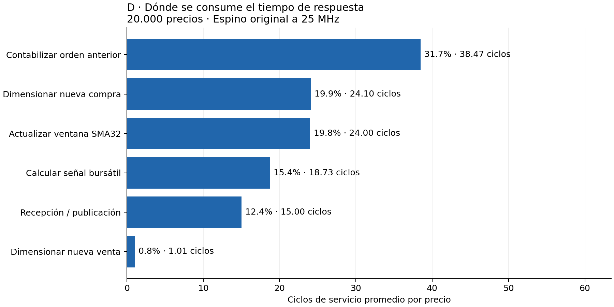
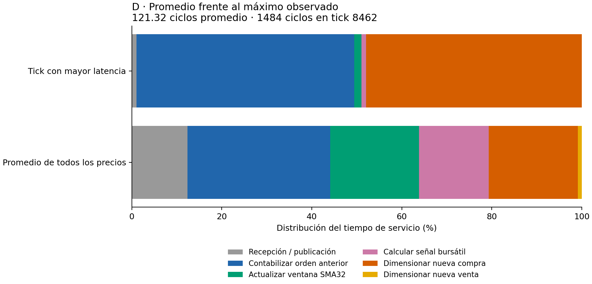
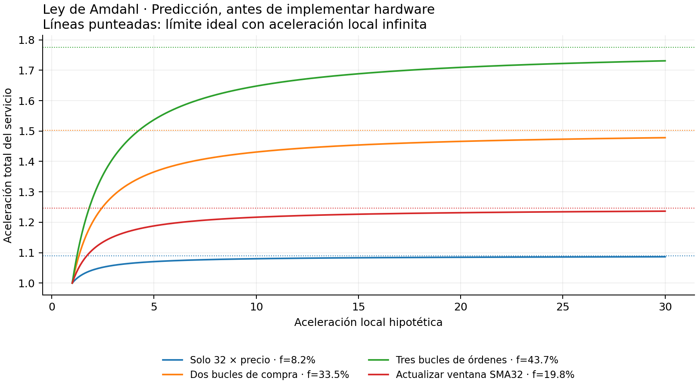

# Perfil de D: qué conviene optimizar

Medición del 12 de noviembre de 2026. Estrategia fija: D, reversión a la media SMA32, banda 1, sin techo de retiro. Espino y Pochoco originales a 25 MHz. Esta etapa mide y propone; no implementa todavía aceleradores ni modifica el programa bursátil.

**Resultado principal:** los tres bucles de órdenes consumen el **43,69% del tiempo de servicio promedio**. Los dos bucles de compra explican el **93,80% del tick de mayor latencia**. Conviene trabajar en el cálculo de cantidades y en la contabilidad de las órdenes. La media ya se actualiza de forma incremental, sin recorrer 32 muestras en cada precio.

## 1. Método y controles

Se instrumentó pasivamente `tb/tb_strategy_d.sv`. Un mapa de direcciones generado desde `sw/trade.s` asigna cada instrucción a una de 12 regiones; se agregan en seis secciones principales. Los contadores viven exclusivamente en el banco de pruebas: no hay stores, instrucciones o hardware adicional dentro del sistema medido.

Se acumula cada ciclo en `(byte_done, escritura de DECISION]`. Cuando ID es válido se usa el PC observado, incluidos sus stalls; durante una burbuja se conserva el último PC válido. Es una convención de atribución por instrucción, no una prueba de causalidad de cada ciclo del pipeline. El costo de una frontera entre secciones puede quedar atribuido a la instrucción anterior. Los totales del servicio sí son exactos.

El conteo de instrucciones conserva la convención previa: incluye un eventual retiro coincidente con `byte_done`. Por eso no se usa IC como sustituto de los ciclos para calcular la fracción de Amdahl. El sondeo anterior a la llegada del precio y la transmisión SPI anterior a `byte_done` quedan fuera del servicio medido.

Controles realizados:

- En cada tick, la suma de ciclos e instrucciones de las 12 regiones coincide exactamente con la medición total. El banco aborta ante una discrepancia.
- El histograma independiente por PC conserva los mismos totales.
- Las **22.000 filas** de mediciones nuevas coinciden con la evidencia previa sin perfil: órdenes, caja, acciones, instrucciones y ciclos. La instrumentación no perturba el programa.
- Se mantienen los controles de equivalencia contra Python, protocolo SPI, caja e inventario, ausencia de valores desconocidos y deadline.
- Las 29 pruebas unitarias existentes pasan. El HEX de D y los 13 archivos RTL siguen intactos.

Dos pruebas distintas, sin mezclar sus resultados:

| Prueba | Precios | Cadencia | Ciclos promedio | Máximo observado | CPI agregado |
|---|---:|---|---:|---:|---:|
| Práctica completa | 20.000 | Se omite espera ociosa entre intercambios | 121,315 | 1.484 | 2,203 |
| Ronda rápida original | Primeros 2.000 | Período fijo 100 us | 112,338 | 1.227 | 2,215 |

En ambas, CPU 25 MHz y SPI 1 MHz. La primera permite perfilar toda la serie sin simular la espera larga; **no equivale a ejecutar 20.000 precios con período fijo**. La segunda comprueba la cadencia rápida sobre los 2.000 precios predeterminados. El máximo es observado en estas series, no una cota demostrada para toda entrada posible.

## 2. Dónde se consume el tiempo

Resultados del archivo completo:

| Sección | Ciclos promedio por precio | Fracción del servicio |
|---|---:|---:|
| Contabilizar la orden anterior | 38,472 | 31,71% |
| Dimensionar una nueva compra | 24,098 | 19,86% |
| Actualizar ventana SMA32 | 24,000 | 19,78% |
| Calcular la señal bursátil | 18,731 | 15,44% |
| Recibir precio y publicar decisión | 15,000 | 12,36% |
| Dimensionar una nueva venta | 1,015 | 0,84% |

La contabilidad incluye controles y dos bucles: compra ejecutada 16,23%, venta ejecutada 10,22%. El bucle para dimensionar una compra futura ocupa otro 17,23%. Juntos son 43,69%; no se suman nuevamente a las secciones anteriores porque están contenidos en ellas.



Dentro de la señal, calcular `32*precio` mediante cinco duplicaciones ocupa 8,23% del servicio. El resto de la señal y los saltos ocupan 7,21%. Habilitar un shift únicamente para esas cinco sumas tiene un alcance limitado; usar shifts también para reemplazar bucles es una propuesta distinta y requiere otra medición.

Los primeros 2.000 precios muestran el mismo orden de prioridades: contabilidad 29,49%, cantidades de compra 19,20%, ventana 21,36%, señal 16,09%. Las fracciones dependen de la serie y de cuántas operaciones se intenten; no son propiedades universales de D.

## 3. Promedio y caso de mayor latencia

El tick 8.462, precio 126, es el de mayor latencia observada: **1.484 ciclos = 59,36 us**, frente al presupuesto conservador de 2.262 ciclos = 90,48 us. La cartera queda con caja 7.992 y 63 acciones; la nueva orden propone comprar 63. En ese tick se contabiliza una compra anterior y se calcula otra compra de tamaño máximo.

| Sección | Ciclos en ese tick |
|---|---:|
| Contabilidad | 719 |
| Cantidad de nueva compra | 711 |
| Ventana | 24 |
| Señal | 15 |
| Recepción/publicación | 15 |

Los dos bucles de compra, excluyendo sus controles, suman 1.392 ciclos: **93,80%** del total. Una mejora modesta en promedio podría ser muy valiosa para aumentar el margen del deadline.



## 4. Ley de Amdahl, como en la clase 7

La clase 7, diapositivas 43–45, generaliza Amdahl a cualquier mejora y recomienda medir antes de optimizar. Para una fracción medida `f` del tiempo acelerada localmente por `s`:

`S_total = 1 / ((1-f) + f/s)`

Con aceleración local ideal infinita, `S_max = 1/(1-f)`. Los ejemplos siguientes mantienen constantes el reloj y el costo de las demás secciones y omiten el costo de integrar el acelerador. **Son predicciones, no resultados de hardware implementado.**

| Región acelerada | f promedio | S total si la región mejora 10× | Límite ideal |
|---|---:|---:|---:|
| Solo calcular `32*precio` | 8,23% | 1,080× | 1,090× |
| Dos bucles de compra | 33,47% | 1,431× | 1,503× |
| Tres bucles de órdenes | 43,69% | 1,648× | 1,776× |
| Actualizar ventana | 19,78% | 1,217× | 1,247× |

Para los dos bucles de compra en el tick 8.462, `f=0,9380`: una mejora local 10× predice 6,419× en **ese tick**, y el límite ideal es 16,130×. Eso no garantiza el mismo speedup del máximo de la serie: otro tick puede pasar a ser el más lento. Cada variante deberá medirse de nuevo por completo.



Estas aceleraciones se refieren al tiempo de respuesta de la CPU. Si la maestra mantiene un período fijo y ya no se pierden órdenes, terminar antes no cambia automáticamente las decisiones, el patrimonio ni la duración de la ronda. Sí aumenta el margen de respuesta y permite demostrar el co-diseño y las métricas exigidas por §3.3 del enunciado.

## 5. Prioridad propuesta para la siguiente implementación

**Primero, probar un atajo de software para órdenes saturadas y volver a perfilar.** De 727 compras propuestas, 433 piden 63 acciones; de 727 órdenes de compra anteriores procesadas, 427 efectivamente compran 63. En la nueva compra, comprobar si `caja-5 >= 63*precio` permite devolver 63 directamente; `63*precio` puede calcularse como `64*precio-precio` sin cambiar Espino. La ganancia neta depende del costo del chequeo agregado a los casos no saturados: aún no se implementó ni midió. Debe conservar exactamente las órdenes y los límites de caja.

**Luego comparar dos alternativas de hardware enfocadas en esos costos.** Candidatas para diseñar, sujetas a recursos y nuevas mediciones:

1. Habilitar desplazamientos y utilizarlos en algoritmos binarios acotados para cantidades y productos, reduciendo los bucles de hasta 63 pasos. El objetivo relevante es reemplazar bucles, además del uso sencillo en `32*precio`.
2. Una operación específica o periférico pequeño para calcular la cantidad asequible, limitada a 63, con precio de 8 bits y presupuesto correcto. Puede atacar los dos bucles de compra. Un diseño que también devuelva el remanente o acelere productos se evaluaría por su costo real de área e integración.

Estas son candidatas, no elecciones cerradas. La base ya ocupa 1.082/1.280 celdas lógicas y 12/16 BRAM; se debe medir qué cabe y cierra timing. Cualquier acelerador debe preservar caja, cantidades, comisiones, redondeos y ejecución al precio siguiente. La implementación del atajo cambiará `f`; las predicciones de esta carpeta corresponden exclusivamente a la base de 84 instrucciones anterior a ese cambio.

Un multiplicador centrado solo en el bucle de ventas afectaría aproximadamente 10,22% del tiempo promedio y no los dos bucles que dominan el tick más lento. Acelerar la ventana tiene interés para el promedio, con poco impacto en ese máximo. Estas observaciones permiten justificar por qué se prioriza cada alternativa.

## 6. Archivos para el informe

- `practica_20000/` y `ronda3_2000/`: tres figuras en PNG y SVG por prueba, tablas de secciones, detalle por kernel, histograma por instrucción, tabla Amdahl y desglose del tick más lento.
- En esas carpetas: `metrics.csv`, `profile_ticks.csv`, `profile_pc.csv`, `pc_map.csv`, `profile_metadata.json`, `result.json`, `resumen.json` y `ejecucion.txt` conservan la medición original, su mapa y el resultado de la validación.
- `procedencia.json`: hashes del programa, datos, RTL e instrumentación, reloj y revisiones de referencia.
- `verificacion.json`: paridad exacta con la evidencia previa sin instrumentar.
- `casos_limite_63.json`: conteo de órdenes saturadas que motiva la siguiente prueba.
- Código reproducible: `tools/profile_d.py`, `tools/verify_strategy_d.py` y `tb/tb_strategy_d.sv`, versionados junto a esta evidencia.

Cada figura tiene una versión SVG editable y una PNG de 180 dpi. Los títulos y leyendas distinguen mediciones de predicciones. Estas figuras pueden incorporarse al informe; acompañarlas de la definición del servicio medido y de la diferencia entre las dos cadencias.

## 7. Reproducir desde la raíz del proyecto

```sh
python3 tools/verify_strategy_d.py --fast --profile --name perfil_D_20000
python3 tools/verify_strategy_d.py --ticks 2000 --profile --name perfil_D_2000_ronda3
python3 tools/profile_d.py build/strategy_d/perfil_D_20000 docs/informe/01_perfil_D_2026-11-12/practica_20000
python3 tools/profile_d.py build/strategy_d/perfil_D_2000_ronda3 docs/informe/01_perfil_D_2026-11-12/ronda3_2000
```

Las simulaciones usan biblioteca estándar de Python, Icarus/vvp y el modelo BRAM de Yosys. Los gráficos requieren `requirements-plots.txt`. Las simulaciones conservan sus salidas originales en `build/strategy_d/`; la carpeta del informe contiene copias archivadas. Las futuras variantes deberán usar otros nombres de carpeta para conservar esta base.
