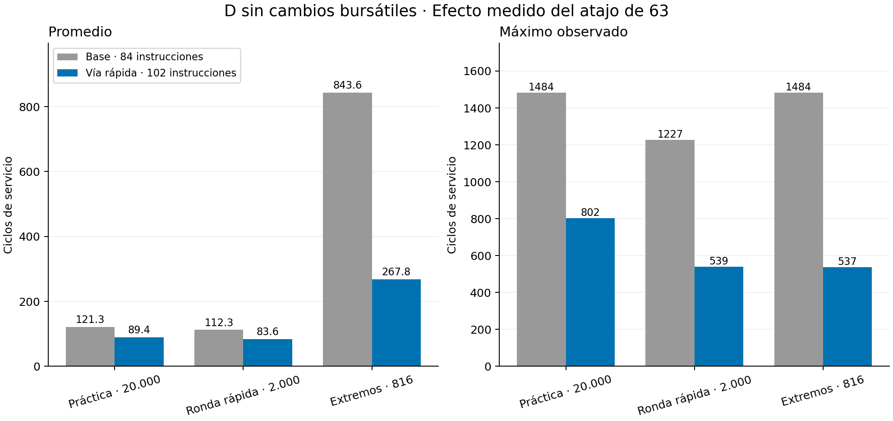
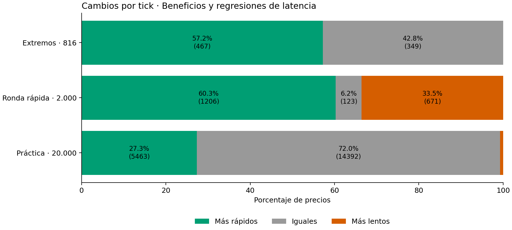
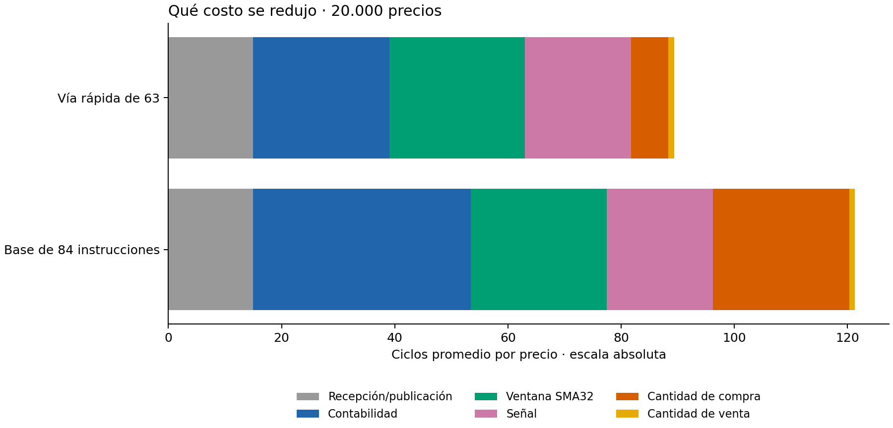

# Vía rápida de 63: implementación y evaluación

12 de noviembre de 2026. **Decisión: conservar la mejora de software.** Las órdenes y la contabilidad de D permanecen idénticas; el tiempo promedio disminuye 26,33% en la práctica completa y el máximo observado baja de 1.484 a 802 ciclos. No se modificó el RTL, el reloj ni la estrategia bursátil.

## Cambios realizados

Se conserva la base original en `sw/trade_base_84.s` y `.hex`, con copias adicionales en `codigo/base/`. El programa actual `sw/trade.s` contiene la mejora, también archivada en `codigo/optimizada/`.

Al contabilizar una compra anterior:

1. Se reserva la comisión: `presupuesto=caja-5`. Si no alcanza para una acción, no hay ejecución.
2. Si la orden previa pide 63, se calcula `costo63=64*precio-precio` mediante seis duplicaciones y una resta.
3. Si `presupuesto>=costo63`, se actualiza directamente `caja=presupuesto-costo63` e inventario `+63`.
4. Si la orden pide menos de 63 o no alcanza para las 63 al precio nuevo, se conserva el bucle original que recorta la compra a lo asequible.

Al dimensionar una compra nueva:

1. Se comprueba si `caja-5` alcanza para una acción. Esta condición es equivalente al resultado q=0 del cálculo anterior y evita iniciar el bucle en ese caso.
2. La señal ya calculó `32*precio`; ahora se conserva ese resultado en x14. Duplicarlo y restar el precio produce `63*precio` con dos instrucciones adicionales.
3. Si alcanza, se publica la orden comprar 63. Si no, se mantiene el cálculo original por restas.

Dimensionar la compra no descuenta caja. La ejecución se contabiliza al precio siguiente, manteniendo el desfase del protocolo. La comisión se descuenta una sola vez por orden efectivamente ejecutada. El atajo solo opera con las reglas ya existentes: precio 1..255, comisión 5 y máximo 63 por orden. No agrega límite de exposición ni techo de patrimonio.

Se conservan SMA32, banda 1, calentamiento de 32 muestras, comparaciones estrictas y marcado final del patrimonio sin liquidación automática. No se agregan instrucciones al repertorio de Espino: solo se utilizan operaciones que ya soportaba.

## Equivalencia y cobertura

Las dos implementaciones coinciden en **22.816 precios comparados**: precio, orden siguiente, caja e inventario. El banco también verifica MISO como orden anterior, una respuesta por precio, ausencia de valores desconocidos y deadline. Los acumuladores del perfil conservan instrucciones y ciclos de cada tick y del histograma por PC. Las 29 pruebas unitarias pasan.

- Práctica completa: 20.000 precios, omitiendo espera ociosa; CPU 25 MHz y SPI 1 MHz. No es una ronda completa de período fijo.
- Ronda rápida: primeros 2.000 precios con período fijo de 100 us.
- Extremos técnicos: 816 precios con niveles 1/255, transiciones, igualdad de banda y valores pseudoaleatorios con semilla 4. Se ejecutaron de nuevo la base y la candidata con el mismo banco. La base reproduce además todas las mediciones extremas archivadas anteriormente, incluidos ciclos e instrucciones.

El conteo real de instrucciones confirma 433 entradas a la vía rápida de nueva compra y 427 a la vía rápida contable en los 20.000 precios. Coinciden con los casos elegibles calculados desde las trazas. Otras seis órdenes previas de 63 se ejecutan por menos al cambiar el precio y utilizan el tratamiento original. Ver `comparacion.json`.

El resultado bursátil completo sigue siendo **17.909**, con caja 11.735, 63 acciones, 1.415 órdenes y comisiones 7.075. Los primeros 2.000 terminan en 9.923, igual que antes. Los extremos artificiales son pruebas técnicas y no evidencia financiera.

## Rendimiento medido

| Serie | Promedio base | Promedio nuevo | Menor tiempo promedio | Aceleración promedio | Máximo base → nuevo |
|---|---:|---:|---:|---:|---:|
| Práctica, 20.000 | 121,315 | 89,378 | 26,33% | 1,357× | 1.484 → 802 |
| Ronda rápida, 2.000 | 112,338 | 83,566 | 25,61% | 1,344× | 1.227 → 539 |
| Extremos, 816 | 843,648 | 267,781 | 68,26% | 3,151× | 1.484 → 537 |

Unidades de promedio y máximo: ciclos desde `byte_done` a escritura de DECISION. Se conservan las convenciones del [perfil inicial](../01_perfil_D_2026-11-12/README.md). No incluyen la espera anterior al precio ni la transmisión SPI previa a `byte_done`.

En la práctica completa, el promedio pasa de 4,853 a 3,575 us. El máximo observado pasa de 59,36 a **32,08 us**, con presupuesto conservador de 90,48 us. El tick de máximo puede cambiar; no es una demostración de peor caso para toda entrada posible.

El programa estático crece de 84 a **102 instrucciones**, de 336 a **408 bytes**, 72 bytes adicionales. La memoria de la ventana sigue siendo 128 bytes en `0x600..0x67c`, sin solaparse con el código. Se utiliza el registro temporal x14, disponible en RV32E. En la práctica completa las instrucciones dinámicas de servicio disminuyen de 1.101.345 a 811.539. Un programa estático algo mayor puede ejecutar muchas menos instrucciones gracias a evitar repeticiones.

El CPI agregado del servicio permanece prácticamente igual: 2,2030 → 2,2027. La aceleración procede de ejecutar menos instrucciones, conservando el reloj y la microarquitectura.

## Costos y regresiones individuales

| Serie | Ticks más rápidos | Iguales | Más lentos | Mayor regresión |
|---|---:|---:|---:|---:|
| Práctica, 20.000 | 5.463 | 14.392 | 145 | +21 ciclos / 0,84 us |
| Ronda rápida, 2.000 | 1.206 | 123 | 671 | +16 ciclos / 0,64 us |
| Extremos, 816 | 467 | 349 | 0 | 0 |

El chequeo de 63 agrega trabajo cuando se termina tomando la vía original. Con cadencia fija también cambia la fase del sondeo de estado: responder antes modifica cuándo se vuelve al bucle de espera, y el siguiente precio puede detectarse unos ciclos antes o después. Por eso los conteos de regresiones de las dos cadencias no deben compararse como si midieran solo el chequeo aritmético. Ninguna regresión observada incumple el plazo.

La mejora se conserva porque las tres pruebas reducen el promedio y el máximo observado con equivalencia exacta, por un costo de 72 bytes y sin nuevos recursos físicos. No se afirma que cada tick o toda serie desconocida vaya a acelerar por igual.

## Nuevo perfil y Amdahl

| Sección | Base: ciclos/precio | Nueva: ciclos/precio |
|---|---:|---:|
| Contabilidad | 38,472 | 24,033 |
| Cantidad de compra | 24,098 | 6,599 |
| Ventana SMA32 | 24,000 | 24,000 |
| Señal | 18,731 | 18,731 |
| Recepción/publicación | 15,000 | 15,000 |
| Cantidad de venta | 1,015 | 1,015 |

La ventana y la contabilidad ahora representan aproximadamente 26,85% y 26,89% del servicio, respectivamente. La ventana no se hizo más lenta: conserva sus 24 ciclos y aumenta su porcentaje al reducirse el total. Para las futuras alternativas de hardware se debe usar este perfil nuevo.

Para explicar el resultado mediante Amdahl se agrupan los dos bucles de compra **y sus controles**, ya que también se modificó la salida temprana q=0. Esa región ocupaba `f=0,36545` en la base y obtiene aceleración local medida `s=3,5761`. La fórmula `1/((1-f)+f/s)` produce **1,3573×**, coincidente con la aceleración total medida; las demás regiones conservan exactamente sus ciclos agregados en esta prueba.

Esta cuenta es **retrospectiva**, porque utiliza el costo local medido; no es una predicción independiente acertada de antemano. La predicción previa permanece en la carpeta 01 y consideraba otras fracciones y aceleraciones hipotéticas. No se aceleró diez veces toda la región inicialmente señalada ni se eliminaron los bucles de venta.

## Compilación para placa

La imagen con la nueva versión se generó correctamente, sin programar la placa. Ocupa 1.082/1.280 celdas lógicas y 12/16 BRAM, igual que la base. nextpnr aprueba 25 MHz; Fmax final estimada 44,81 MHz. El reloj implementado sigue siendo 25 MHz. Consultar `compilacion.json` y las copias de los registros de síntesis y place-and-route.

El cambio de programa altera el contenido inicial de RAM de la imagen; no altera los 13 archivos RTL ni los pines. Las advertencias heredadas de pines UART sin uso y de HEX menor que 512 palabras permanecen. El anillo se escribe antes de leerse.

## Evidencia y reproducción

`practica_20000/`, `ronda3_2000/` y `extremos/` contienen carpetas `base/` y `optimizada/`: mediciones por tick, perfil por sección y PC, mapa de código, resumen y configuración. Cada candidata incluye diferencias por tick. `codigo/` conserva ambos programas y HEX. `comparacion.csv/json`, `cambios_por_seccion.csv`, `procedencia.json` y los gráficos PNG/SVG reúnen los resultados para el informe.

Los hashes del programa, datos, herramientas de medición y RTL quedan registrados. La base original tiene HEX SHA256 `bc5b2ce13fbb1c5cf36486943c6afbb3ead9516582711ef253c0475462bb3b80`; la optimizada `d47259a758a2a8ff2cf427a0525e2355f28c7dee375e6ce124244342088df5ae`.

Desde la raíz del proyecto, `make compare-fastpath63` repite las cuatro simulaciones necesarias y genera esta comparación. También puede ejecutarse `python3 tools/compare_fastpath63.py` para regenerar análisis y gráficos desde las mediciones ya presentes en `build/strategy_d/`. Los gráficos requieren `requirements-plots.txt`.

Para ejecutar manualmente la base conservada se usa `--program sw/trade_base_84.s`. El banco acepta la imagen como parámetro y cada prueba ensambla una copia propia en su carpeta de salida, evitando interferencias entre simulaciones. La carpeta 01 queda como evidencia histórica de la base; el objetivo `profile-d` ahora genera esta comparación sin sobrescribirla.

Esta etapa termina con la mejora de software conservada y documentada. Las dos alternativas de hardware del enunciado y la prueba SPI física siguen pendientes y no se implementan como parte de este experimento.
