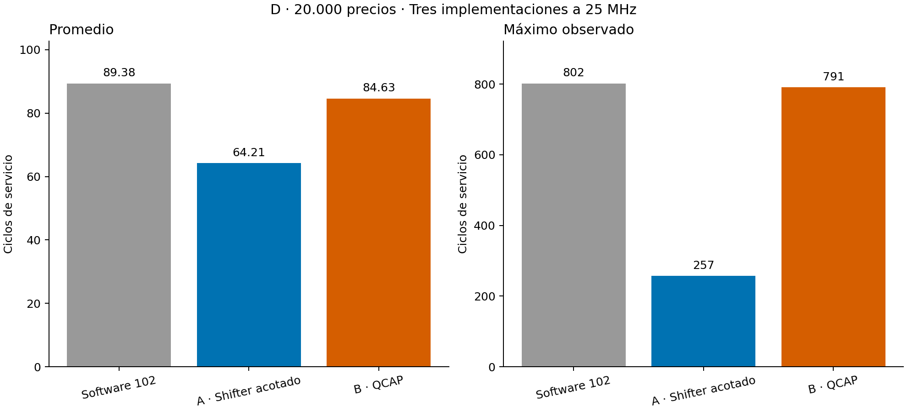
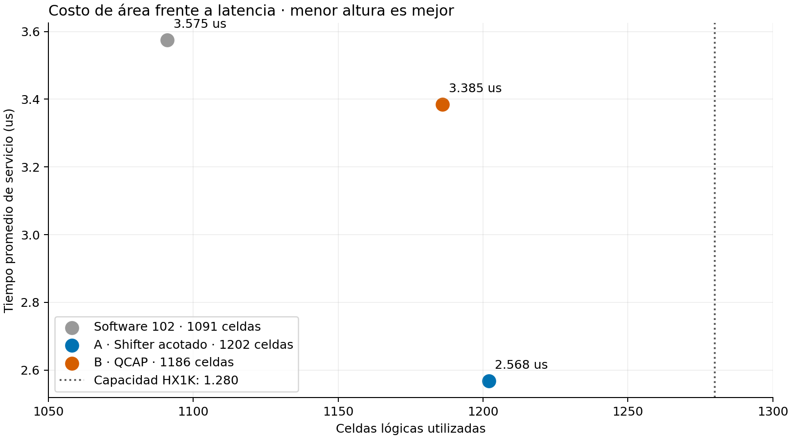
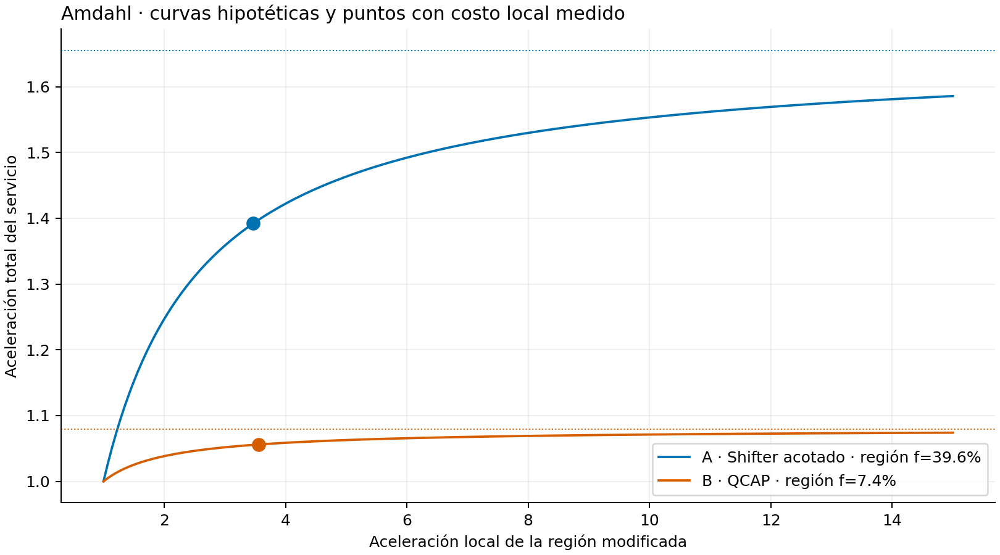
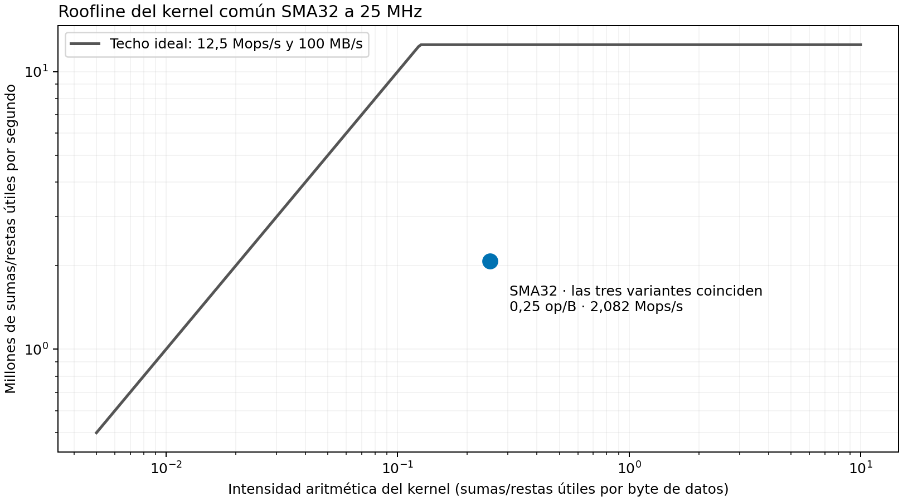

# Dos alternativas de hardware para D

12 de noviembre de 2026. **Recomendación: alternativa A, desplazamientos inmediatos acotados y algoritmos binarios.** Se implementaron, simularon y compilaron A y B/QCAP, comparándolas con la mejor versión solo software de 102 instrucciones. Los autodiagnósticos de ambas variantes también pasaron en la Go Board, antes y después de desconectar USB. El intercambio SPI físico con la maestra del curso todavía no se ha probado.

La estrategia sigue siendo **D: SMA32, banda 1, sin techo de retiro**, con las mismas cantidades, comisiones y ejecución al precio siguiente. Los nombres A/B de esta carpeta corresponden a implementaciones de hardware; no son las antiguas estrategias bursátiles A y B.

## 1. Qué cambió

### A · Desplazador acotado

La primera prueba habilitó un barrel shifter lógico general de 32 bits. No cupo: necesitaba **1.346 celdas frente a 1.280 disponibles**. Se conservaron fuentes y registros en `descartes/barrel32/`.

La versión que sí cabe implementa únicamente los desplazamientos inmediatos que necesita el programa: **SLLI 1/5/6 y SRLI 1**. Los resultados siguen siendo de 32 bits completos; no se truncan operandos a un byte. El decoder y el ensamblador rechazan las otras cantidades, desplazamientos por registro y desplazamientos aritméticos. No se presenta como una implementación completa de todos los shifts de RV32I.

El assembly conserva el atajo de 63 y utiliza los shifts para:

- Calcular `32*precio` y `64*precio` directamente.
- Obtener cantidades asequibles mediante seis pruebas binarias, desde 32 acciones hasta una. Al contabilizar una compra, también se respeta la cantidad de la orden anterior.
- Calcular los ingresos de ventas con multiplicación binaria por una cantidad de seis bits, evitando hasta 63 sumas sucesivas.

Fuentes: `variants/shifter/rtl/` y `sw/trade_shifter.s`. Se reemplazan ALU y decoder, conservando el resto del core.

### B · Instrucción especializada QCAP

`qcap rd, rs1, rs2` devuelve `min(63, unsigned(rs1)/unsigned(rs2[7:0]))`. Precio cero devuelve cero como definición de la instrucción; los datos bursátiles válidos siguen teniendo precios 1..255. Usa custom-0, opcode `0x0b`, funct3=0, funct7=0, registros x0..x15.

Una unidad de 14 bits realiza seis intentos binarios. Si el presupuesto tiene bits superiores al 13, necesariamente alcanza para 63 acciones a cualquier precio válido, por lo que se responde 63. Así se evita un divisor general de 32 bits. La etapa ID mantiene detenido el core hasta que termina y escribe el resultado una vez. La unidad conserva la respuesta hasta el retiro.

El programa la utiliza para dimensionar nuevas compras. La contabilidad previa mantiene el software. Espino continúa leyendo precios, actualizando la media, tomando la decisión y publicándola; el hardware no reemplaza el ciclo de decisión.

Fuentes: `variants/qcap/rtl/` y `sw/trade_qcap.s`. Se reemplazan decoder y etapa ID y se agrega `espino_qcap.v`; no se habilitan shifts en esta alternativa.

## 2. Corrección de arranque encontrada en la placa

La simulación de RTL, del circuito sintetizado y del circuito extraído del ruteo aprobaba el autodiagnóstico. En la placa hubo resultados distintos: primero EE y luego E3, correspondiente a `255<<5`; una sonda mostró resultado 0 frente a esperado 8160. Tras desconectar USB volvió a fallar, y una prueba repetida no llegó a su marcador de término.

Se agregó temporalmente telemetría UART para no depender de lecturas manuales de botones. La captura de la primera instrucción con reset de 15 ciclos mostró `0x00008000` donde el programa contenía `0x800000B7`. Con una espera inicial de **63 ciclos**, la captura coincidió, también después de quitar alimentación. Luego los autodiagnósticos completos de A y QCAP pasaron tanto recién programados como tras desconectar/reconectar.

Se conservó ese cambio mínimo en `rtl/pochoco_soc.v`: contador de reset de seis bits, 63 ciclos, aproximadamente **2,52 us a 25 MHz**, frente a los 0,60 us anteriores. El resto de la CPU base permanece sin cambios. **El reset común se aplicó también a la referencia solo software y se repitieron todas las mediciones**, para comparar configuraciones equivalentes. El cambio no añade trabajo por precio ni modifica el reloj.

La evidencia demuestra que esta modificación resolvió las pruebas observadas; no demuestra por sí sola el fenómeno eléctrico o de configuración exacto que produjo la primera lectura incorrecta. No se atribuye el fallo al algoritmo ni se afirma que el simulador modele todo el proceso físico de arranque. Las capturas antiguas con cabecera UART de un byte se consideran ambiguas; la captura utilizada tiene cabecera completa y un transmisor verificado en RTL.

Ver [registro físico](prueba_placa.md), `diagnostico_arranque/observaciones.md`, capturas UART y la copia del SoC anterior. `resultados_previos_reset15.zip` conserva el experimento previo a la corrección; los resultados principales siguientes usan reset de 63 ciclos.

## 3. Equivalencia comprobada

Para cada una de las tres implementaciones se ejecutaron:

| Prueba | Precios | Cadencia |
|---|---:|---|
| Práctica completa | 20.000 | Sin espera ociosa entre intercambios |
| Ronda rápida | Primeros 2.000 | Período fijo de 100 us |
| Extremos técnicos | 816 | Sin espera ociosa |

En todas, CPU a 25 MHz y SPI a 1 MHz. La prueba sin espera ociosa verifica toda la secuencia y latencias, pero no es una ronda completa de período fijo. Los primeros 2.000 sí reproducen la cadencia rápida del ejemplo.

Las **68.448 ejecuciones de precios**, contando las tres pruebas por implementación, coinciden por tick en orden, caja e inventario con la referencia de D. Se verifica también el byte MISO anterior, una lectura y una respuesta por precio, deadline y ausencia de valores desconocidos. La práctica completa termina siempre en patrimonio **17.909**, caja 11.735, 63 acciones y 1.415 órdenes. Los primeros 2.000 terminan en 9.923. Los extremos son una prueba técnica artificial y no evidencia financiera.

Pruebas adicionales:

- 32 pruebas Python, incluyendo codificación exacta y rechazo de extensiones no disponibles.
- 16.387 operaciones de shifter, con operandos de 32 bits, desbordamientos, decoder y restricciones.
- 6.649 casos QCAP: fronteras para los 255 precios válidos, precio cero, presupuestos grandes, casos pseudoaleatorios de 14 y 32 bits, retención y reset durante operación.
- Pruebas dentro del SoC real: instrucciones consecutivas, dependencias, rd=rs1, descarte de escritura a x0 y presupuestos completos de 32 bits.
- Pruebas anteriores de protocolo y los autodiagnósticos físicos indicados en el registro de placa.

Cada fila de perfil conserva el total de instrucciones y ciclos; el histograma por PC aporta un control independiente. Los máximos reportados son observados en las entradas evaluadas, no una demostración de peor caso para toda serie posible.

## 4. Rendimiento, recursos y elección

Práctica completa, con el mismo reloj implementado de 25 MHz:

| Implementación | Ciclos promedio | Máximo observado | Tiempo promedio | Tiempo máximo | Speedup promedio |
|---|---:|---:|---:|---:|---:|
| Software 102 | 89,378 | 802 | 3,575 us | 32,08 us | 1,000× |
| A · Shifter acotado | **64,210** | **257** | **2,568 us** | **10,28 us** | **1,392×** |
| B · QCAP | 84,632 | 791 | 3,385 us | 31,64 us | 1,056× |



| Implementación | Celdas lógicas / 1.280 | BRAM / 16 | Fmax estimada | Instrucciones estáticas |
|---|---:|---:|---:|---:|
| Software | 1.091 | 12 | 46,07 MHz | 102 |
| A | 1.202 | 12 | 42,24 MHz | 105 |
| B | 1.186 | 12 | 43,87 MHz | 90 |

Todas cierran timing a 25 MHz. Fmax es una estimación de nextpnr, no la frecuencia aplicada ni una medición eléctrica. No se usa PLL. Las cifras de área incluyen el SoC y el reset común corregido; las cifras anteriores al reset se conservan como historia y no se mezclan en esta tabla.



La ronda fija de 2.000 obtiene promedios 83,566 / 63,639 / 80,065 ciclos, y máximos 539 / 250 / 538, respectivamente. Los extremos obtienen promedios 267,781 / 113,440 / 265,913 y máximos 537 / 168 / 533. Consultar `comparacion.csv` para cifras completas, IC, CPI, regresiones y resultados de cada prueba.

En la práctica completa el CPI agregado es aproximadamente 2,203 / 2,207 / 2,209. La mayor mejora procede de reducir instrucciones dinámicas, no de subir la frecuencia. A ejecuta 29,088 instrucciones promedio por precio, frente a 40,577 de software y 38,321 de QCAP.

**Se recomienda A:** reduce el tiempo promedio 28,16% y el máximo observado 67,96% frente al software optimizado. Usa 16 celdas más que B, con una mejora de latencia mucho mayor. Quedan 78 celdas libres y cuatro BRAM; todavía se necesita conservar margen al añadir cualquier otra función. No se comparó consumo eléctrico y no se afirma ahorro de energía medido.

Existen regresiones individuales. En los 20.000 precios A tarda más en 100 ticks, hasta 58 ciclos adicionales; B en 296, hasta un ciclo adicional. Los algoritmos binarios siempre prueban seis bits, por lo que ciertos casos pequeños pueden costar más que las pocas iteraciones originales. Todas las regresiones medidas permanecen dentro del presupuesto conservador de 2.262 ciclos/90,48 us.

## 5. Amdahl

Se aplica `S=1/((1-f)+f/s)` a regiones disjuntas del perfil de software de 102 instrucciones:

| Variante | Región modificada, f | Hipótesis local 2× | Hipótesis local 4× | Límite ideal | Speedup total medido |
|---|---:|---:|---:|---:|---:|
| A | 39,57% | 1,247× | 1,422× | 1,655× | 1,392× |
| B | 7,38% | 1,038× | 1,059× | 1,080× | 1,056× |

Para A se incluyen los controles y bucles de compras y ventas modificados y `32*precio`. Para B se incluye todo el dimensionamiento de compras. No se usa el perfil de la versión antigua de 84 instrucciones para inflar el beneficio esperado del hardware.

Los factores locales de 2×/4× son escenarios hipotéticos, no una garantía ni una predicción independiente calibrada. Usando después los costos locales medidos, A acelera su región aproximadamente 3,467× y B 3,561×; Amdahl reconstruye 1,392× y 1,056×. Esa reconstrucción retrospectiva se distingue de los escenarios en `amdahl.csv` y en el gráfico.



QCAP ilustra el límite de Amdahl: una instrucción especializada puede resolver bien su tarea y aun así mejorar poco el programa completo, porque esa tarea ya ocupa una fracción pequeña tras optimizar software. El beneficio de A se distribuye por varias operaciones costosas.

## 6. Operaciones útiles y roofline

Para el servicio completo se define una operación útil como **procesar un precio y dejar preparada una decisión**. La capacidad media calculada desde el tiempo de servicio es aproximadamente 279.711 / 389.349 / 295.396 decisiones/s para software/A/B. No son tasas efectivamente transmitidas por la maestra: una ronda fija de 100 us entrega 10.000 precios/s aunque el core termine antes.

Para el roofline se usa otra unidad explícita y comparable: sumas y restas útiles de la actualización incremental de SMA32. Ese kernel común pasa a ser especialmente importante después de acelerar las órdenes. Se cuentan las instrucciones reales del histograma: 20.000 sumas y 19.968 restas, 159.872 bytes de lecturas/escrituras por el puerto de datos y 479.999 ciclos de la región. Se excluye la búsqueda de instrucciones, como en el modelo de puerto B de la clase 7.

Intensidad aritmética: **0,25 operaciones/byte**. Rendimiento medido: **2,082 millones de sumas/restas útiles por segundo**, igual para las tres variantes, porque no modificaron esta región. Los techos ideales de clase son 12,5 Mops/s para operaciones de dos ciclos a 25 MHz y 100 MB/s para el puerto de 32 bits; el techo en esa intensidad es 12,5 Mops/s. El costo de control y de otras instrucciones de la región explica parte de la separación; no se interpreta el techo de memoria como un ancho de banda sostenido medido.



El roofline describe ese kernel común, no pretende convertir una división QCAP en una suma ni medir todo el programa con una única operación aritmética equivalente. Las dos definiciones de operaciones se mantienen separadas en las tablas.

## 7. Archivos y reproducción

- `mediciones/<serie>/<variante>/`: CSV por precio, histograma por PC, mapa de instrucciones, perfiles, métricas y registros de ejecución.
- `compilacion/<variante>/`: registros de síntesis/ruteo, utilización, Fmax, HEX y hash de imagen.
- `pruebas/`: pruebas unitarias y de instrucciones del SoC.
- `diagnostico_arranque/`: fallos observados, capturas y configuración anterior al reset corregido.
- Cuatro gráficos PNG/SVG: tiempos, área/latencia, roofline y Amdahl.
- `procedencia.json`: hashes de fuentes, datos, RTL y herramientas de medición. `prueba_placa.md` y `placa.json`: observaciones e imágenes verificadas físicamente.

```sh
make test-hardware
make build-shifter
make build-qcap
make compare-hardware
```

`compare-hardware` repite las pruebas con el reset común, compila las tres implementaciones y regenera la comparación. El ensamblador usa `--isa base`, `--isa shifter` o `--isa qcap`; las fuentes se seleccionan sin duplicar módulos. Las imágenes bursátiles quedan en `build/hardware/<variante>/soc.bin`.

La placa queda con el diagnóstico A5, no con la estrategia bursátil. El próximo ensayo físico completo requiere una maestra SPI apropiada; aún debe comprobarse la conexión eléctrica y la ronda del curso. Las herramientas temporales de UART y sondas son solo de diagnóstico y no forman parte del hardware recomendado ni de sus métricas.
