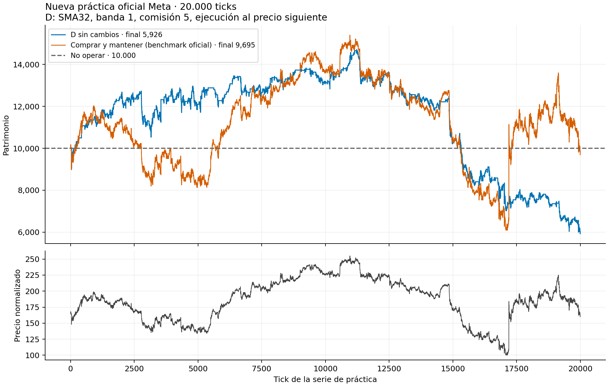
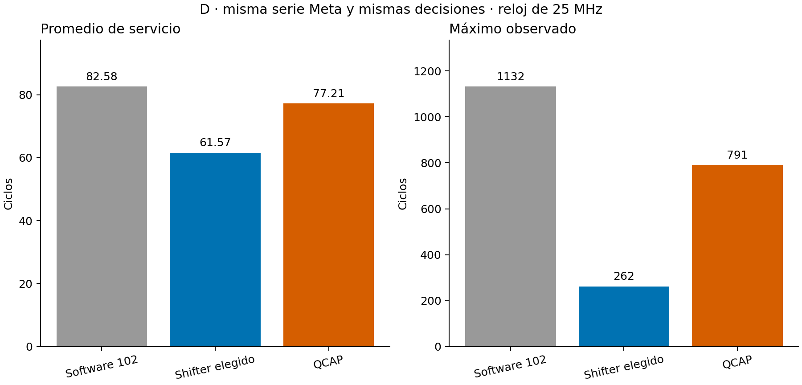
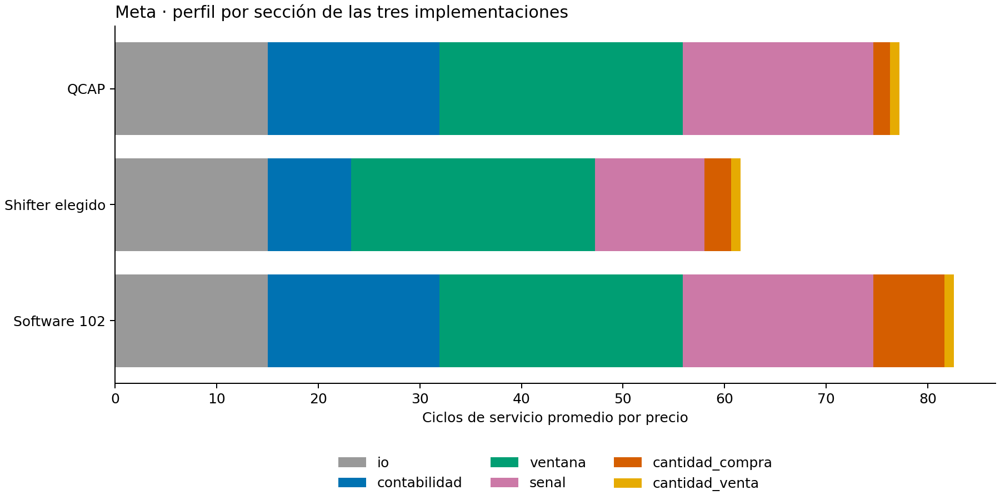

# Nueva práctica oficial Meta — 17 de noviembre de 2026

**Resultado principal:** D sin cambios termina por debajo de no operar y de comprar y mantener. Las tres implementaciones ejecutan exactamente la misma estrategia; el hardware no explica esa pérdida.

## Serie y alcance

El archivo entregado por el usuario es `practica_meta.csv`, que el anuncio del curso identifica como 20.000 precios de Meta, febrero–mayo de 2022, uno por minuto de mercado. El CSV solo contiene tick y precio: activo, período y frecuencia proceden del anuncio, no pueden inferirse de esas dos columnas. Se verificaron 20.000 filas consecutivas, mínimo 100, máximo 255, primer precio 165 y último 160. SHA256 del archivo: `fed122e0a9861276d76b1396b264fd34077c280c80fe6b356b6971d55242da3f`.

La nueva serie está en `tb/practica_meta.csv`. La práctica anterior permanece intacta en `tb/practica.csv`; los resultados del 11–14/11 no se sobrescriben ni se mezclan con esta evaluación. D permanece fijada antes de ver los datos nuevos: SMA32, banda 1, sin retiro por patrimonio, sin filtros adicionales, caja inicial 10.000 y comisión 5. No se buscaron parámetros nuevos.

## Resultado bursátil completo

| Referencia | Patrimonio final | Órdenes | Comisiones | Máxima caída desde un peak |
|---|---:|---:|---:|---:|
| D / SMA32 / banda 1 | **5926** | 722 | 3610 | 8785 |
| No operar | 10000 | 0 | 0 | 0 |
| Comprar y mantener oficial | 9695 | 1 | 5 | 9300 |

D pierde 4074 frente a la caja inicial (-40.74 %) y termina 3769 por debajo de comprar y mantener. Cierra con caja 6 y 37 acciones. Las comisiones son un costo observado importante; restarlas no equivale a simular la estrategia con comisión cero, porque la caja y las cantidades futuras también cambiarían. El benchmark comprar y mantener usa la fórmula oficial de Canvas, compra al primer precio y no representa una estrategia adicional ejecutada por SPI con desfase.



## Equivalencia y tiempos de hardware

Se ejecutaron los 20.000 precios en RTL por SPI para software optimizado, shifter y QCAP. En cada tick se comprueban la siguiente decisión, caja, acciones, una lectura y una respuesta, MISO sin X y deadline. Los HEX coinciden con los evaluados el 12/11: no hubo cambios de firmware. Los tres resultados contables y todas sus decisiones coinciden con Python y entre sí.

| Variante | Promedio ciclos | Máximo observado | CPI de servicio | Reducción de tiempo | Celdas |
|---|---:|---:|---:|---:|---:|
| Software 102 | 82.58305 | 1132 | 2.19573 | 0.00% | 1091/1280 |
| Shifter elegido | 61.57205 | 262 | 2.21108 | 25.44% | 1202/1280 |
| QCAP | 77.21155 | 791 | 2.19899 | 6.50% | 1186/1280 |

Todas las variantes conservan 25 MHz y 12 BRAM. Área y Fmax se reutilizan de la compilación archivada del 12/11 porque RTL e imágenes de programa no cambian al cambiar los precios externos. Cada perfil conserva exactamente los ciclos e instrucciones, por tick, por sección y por PC. El CSV de Amdahl actualiza las fracciones con Meta; la reconstrucción con costo local medido se distingue de los escenarios hipotéticos. El roofline define como operaciones las sumas/restas del anillo SMA32 y cuenta solo bytes de su puerto de datos, sin mezclarlo con decisiones por segundo.

**Método de tiempo:** las corridas completas omiten espera ociosa entre precios (`--fast`); verifican equivalencia y ventana de servicio, pero no constituyen 20.000 ticks con período fijo. Los máximos observados no se presentan como una demostración formal del peor caso posible.





## Maestra simulada de Canvas: ronda rápida

El testbench oficial configurado con la nueva serie y shifter aprobó **4/4 chequeos** en los primeros 2.000 precios, con período fijo de 100.000 ns. Patrimonio de ese tramo: **12498**, 82 órdenes. El runner compara además cada decisión ejecutada y estado contable con Python. No se deben confundir estos resultados parciales con los de 20.000 precios. Las tareas SPI, la contabilidad y los cuatro chequeos del testbench se conservan; solo se configuran rutas/parámetros y se adapta `localparam string` a Icarus.

## Qué significa para la placa del equipo

**El anuncio no obliga a reprogramar.** La imagen cargada el 14/11 acepta 1–255 y recibe los precios por SPI: no contiene ninguna serie precargada. El nuevo CSV se cambia en el simulador o en la maestra, no dentro del bitstream. En esta evaluación no se programó la placa ni se modificaron D o el shifter. El grupo puede probar la conexión con el curso usando la versión que ya tiene.

**Sí conviene reabrir la evaluación de la estrategia bursátil antes de competir.** El resultado anterior de 17.909 no describe esta práctica nueva. Una serie no demuestra que D sea universalmente mala, pero esta pérdida es evidencia que no se debe ocultar ni resolver ajustando a ciegas parámetros para memorizar Meta. Mantener el shifter no obliga a mantener una estrategia si posteriormente el equipo decide cambiarla. Cualquier cambio bursátil requerirá nueva equivalencia y, entonces sí, cargar otro programa en la placa.

El intercambio físico con la maestra sigue pendiente. No se presenta ninguna de estas simulaciones como una ronda física. Confirmar con el curso inicio/reinicio entre rondas; los botones no reinician el estado bursátil de la imagen actual.

## Reproducción y evidencia

```sh
make test-final   # nueva Meta, 2.000 precios, período fijo más rápido
make verify-meta  # 3 implementaciones completas + Canvas + archivo y gráficos
# Práctica histórica, explícitamente:
python3 tools/verify_canvas_final.py --series tb/practica.csv
```

`test-final` usa ahora Meta por defecto. Los demás scripts históricos mantienen sus valores predeterminados anteriores: para nuevas pruebas usar `--series tb/practica_meta.csv`. El objetivo `verify-meta` ya lo hace explícitamente.

`D_python.csv` y `referencia.json` contienen el resultado financiero. `mediciones/<variante>/` contiene todos los ticks, perfiles, instrucciones, resultados y logs; `canvas_2000_ronda3/` guarda el testbench configurado y su salida. `comparacion_hardware.csv`, `amdahl_hardware.csv`, `roofline_sma32.csv` y `procedencia.json` permiten reconstruir las tablas y comprobar las fuentes. Las tres figuras tienen copia PNG y SVG.
